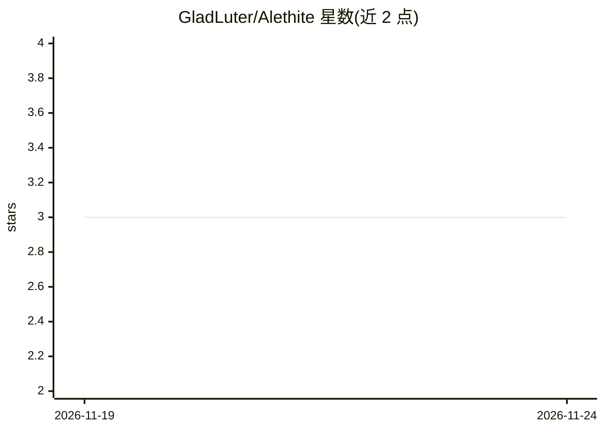

# GladLuter/Alethite

⭐ 3 · Python · MIT · 推送 2026-11-17 · [GitHub](https://github.com/GladLuter/Alethite) · 个人维护

**Windows 下 Claude Code 插件：发送前看价格、聊天交接与本地记忆**

面向 Claude Code 桌面应用的 MIT 许可插件：在提示行上方显示聊天规模、缓存剩余时间与下次发送的价格；提供 clean chat 交接按钮（交接不含模型调用）、本地 SQLite+向量索引保存全部历史对话并支持词与语义检索、错误教训机制、四级机械式记忆压缩、网络盘多机同步与可选加密（SQLCipher/EFS/AES-GCM），并附带以 5-16k token 起始的精简 agent 类型。仅支持 Windows，需 Python 3.8+，Ollama 为可选组件。

## 筛选速览

| 维度 | 判定 | 备注 |
|---|---|---|
| AI 角色 | `ai-enhanced` | 去掉 AI 部分产品仍成立 |
| 许可风险 | `permissive` | MIT |
| 部署形态 | `desktop` | 安装包/桌面程序 |
| 模型依赖 | local-ok | 支持本地模型 |
| 硬件要求 | — | 无带数字的原话,不猜 |
| 安装摩擦 | `low` | 无编译、无系统依赖或容器化 |
| 成熟度 | — | 结构信号不足 |

## 能力要点

- 状态栏显示聊天规模、缓存剩余分钟与发送前价格
- 本地 SQLite+向量索引保存全部历史对话，语义检索依赖本地 Ollama
- 五类精简 agent 类型起始 5-16k token
- 网络盘多机同步与可选 SQLCipher/EFS/AES-GCM 加密

## 适用场景

- 在 Claude Code 长对话中发送前了解本次花费
- 跨会话保留并检索项目决策与教训
- 多台 Windows 电脑间同步聊天记忆索引

## 场景标签

`编码 Agent` `Agent 记忆` · 领域:Agent 开发

## 证据(README 行号)

> L7: A free, MIT-licensed plugin for the Claude Code desktop app on Windows.
> L16: Alethite shows a row above the prompt with the chat size, the cache state and the price of the next send.
> L40: |🔎 **Long memory**|Every past conversation of every project, subagents included, in a local SQLite index with vecto

## 星数曲线

2026-11-19 3 → 2026-11-24 3（+0）

---
*卡片 v1 · prompt 1.4 · 生成 2026-11-22 · 置信度 high · 依据 README sha `9173996db8f9` · [字段定义](../../DATASET.md)*
