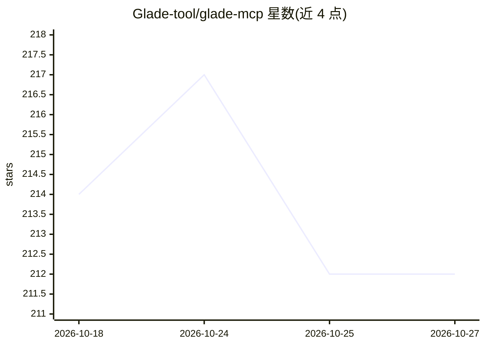

# Glade-tool/glade-mcp

⭐ 212 · C# · MIT · 推送 2026-10-21 · [GitHub](https://github.com/Glade-tool/glade-mcp) · [官网](https://www.gladekit.com/) · 组织维护

**把 MCP AI 客户端接入 Unity/Godot 编辑器的游戏开发工具服务器**

MCP 服务器，将 Claude Code、Cursor、Windsurf 等 AI 客户端连接到 Unity（275 工具/20 类）或 Godot（115 工具/17 类）编辑器，通过编辑器桥接（HTTP :8765 / WebSocket :8766）自动检测引擎。提供玩法脚手架一键生成、脚本语义搜索、find_references/rename_symbol 重构、截图验证循环与构建导出工具。核心功能免费本地运行，云端 RAG 与跨会话记忆为可选付费项（GLADEKIT_API_KEY）。Godot Mono/C# 项目暂不支持。安装经 uvx/pip 与编辑器插件包完成。

## 筛选速览

| 维度 | 判定 | 备注 |
|---|---|---|
| AI 角色 | `ai-ecosystem` | LLM/agent 周边工具 |
| 许可风险 | `permissive` | MIT |
| 部署形态 | `desktop` | 安装包/桌面程序 |
| 模型依赖 | — | README 未给出锁定关系 |
| 硬件要求 | — | 无带数字的原话,不猜 |
| 安装摩擦 | `low` | 无编译、无系统依赖或容器化 |
| 成熟度 | — | 结构信号不足 |

## 能力要点

- 275 Unity + 115 Godot 工具，单服务器自动检测引擎
- 一键玩法脚手架：控制器、敌人、战斗、菜单、存档系统等模板
- 验证循环：look_at_game_view 截图、运行时事件观察、可玩性探测
- true find_references / rename_symbol 脚本重构与构建/导出工具

## 适用场景

- 用 Claude Code/Cursor 在 Unity 或 Godot 编辑器内直接开发游戏
- 让 AI 生成控制器、敌人、菜单等已知良好的游戏脚手架代码
- 通过截图与运行时事件验证 AI 所做的编辑器改动

## 场景标签

`编码 Agent` `代码生成` · 领域:编码与开发

## 证据(README 行号)

> L3: Connect Cursor, Claude Code, Windsurf, Claude Desktop, and other AI clients directly to your Unity or Godot editor.
> L11: The MCP server auto-detects which editor is running (Unity on `:8765`, Godot on `:8766`) and exposes the matching t
> L56: Then add the MCP config to your AI client. The client launches the MCP server automatically - no manual server step

## 星数曲线

2026-10-18 214 → 2026-10-27 212（-2）

---
*卡片 v1 · prompt 1.4 · 生成 2026-10-22 · 置信度 high · 依据 README sha `2e67582254f8` · [字段定义](../../DATASET.md)*
