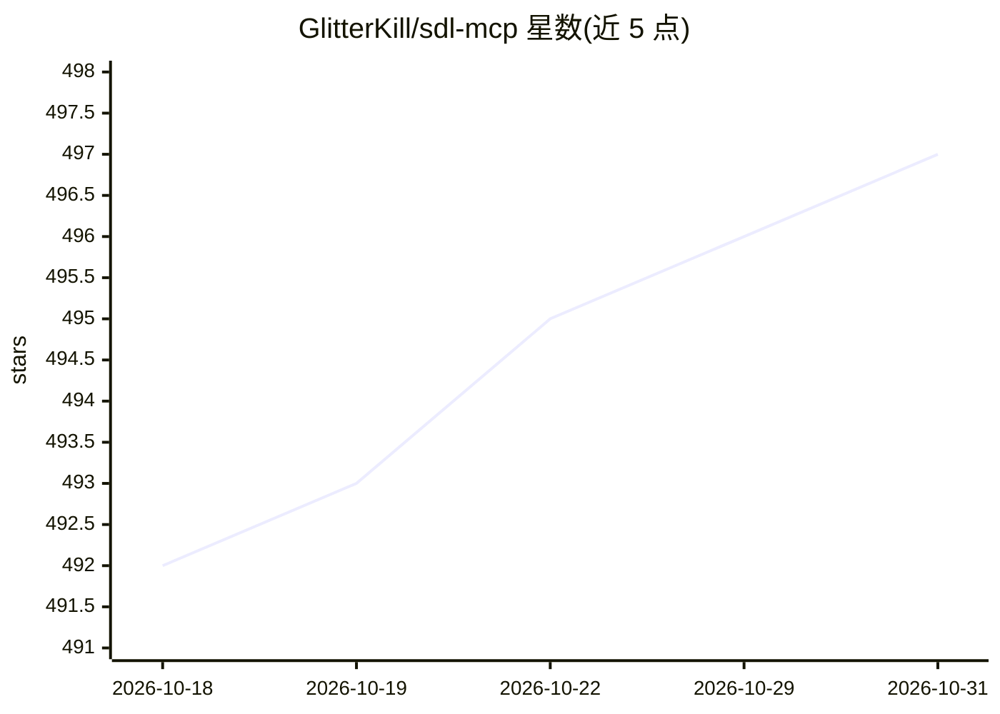

# GlitterKill/sdl-mcp

⭐ 497 · TypeScript · NOASSERTION · 推送 2026-10-29 · [GitHub](https://github.com/GlitterKill/sdl-mcp) · 个人维护

**面向编码 Agent 的代码上下文预算层（MCP 服务器）**

SDL-MCP 将仓库索引为符号图，通过 MCP（stdio/HTTP）向编码 Agent 提供从符号搜索、符号卡片、图切片到受策略控制的源码窗口的逐级检索路径，以缩减 Agent 所需上下文规模。支持 tree-sitter 结构解析与 SCIP/LSP 语言提供方事实接入、版本间 Delta 对比与 PR 风险分析（sdl.pr.risk.analyze）、草稿缓冲实时索引覆盖层，以及可选的开发记忆存储。提供 Flat/Gateway/Code Mode 多档工具面与图查看器、可观测性仪表盘。本地运行，需 Node.js 24+，经 npx 或 npm 全局安装。许可为 source-available：内部商用可，作为商业化产品分发需商业许可。

## 筛选速览

| 维度 | 判定 | 备注 |
|---|---|---|
| AI 角色 | `ai-ecosystem` | LLM/agent 周边工具 |
| 许可风险 | `none` | NOASSERTION |
| 部署形态 | `library` | 以包/库形式分发 |
| 模型依赖 | — | README 未给出锁定关系 |
| 硬件要求 | — | 无带数字的原话,不猜 |
| 安装摩擦 | `low` | 无编译、无系统依赖或容器化 |
| 成熟度 | — | 结构信号不足 |

## 能力要点

- 符号图索引与逐级升级的上下文检索（卡片→骨架→热点路径→受限源码窗口）
- 支持 MCP stdio/HTTP 传输，提供 38 工具 Flat 面与 Gateway/Code Mode 压缩工具面
- Delta 包与 sdl.pr.risk.analyze 输出变更证据与测试建议
- tree-sitter 结构解析，可摄取 SCIP/LSP 提供方事实

## 适用场景

- 让编码 Agent 在大型仓库中以更少 token 定位相关代码
- PR 审查时分析变更符号与受影响关系的爆炸半径
- 为 Agent 提供任务范围的图切片与可检索的开发记忆

## 场景标签

`Agent 记忆` · 领域:Agent 开发

## 证据(README 行号)

> L16: SDL-MCP indexes a repository into a symbol graph and gives coding agents a controlled path from compact metadata to
> L18: The result is a smaller, more deliberate context surface for debugging, reviews, implementation work, and repositor
> L22: SDL-MCP requires Node.js 24 or later. For an interactive first install, run the wrapper package from the repository

## 星数曲线

2026-10-18 492 → 2026-10-31 497（+5）

---
*卡片 v1 · prompt 1.4 · 生成 2026-10-21 · 置信度 high · 依据 README sha `5d0c2bec0e37` · [字段定义](../../DATASET.md)*
