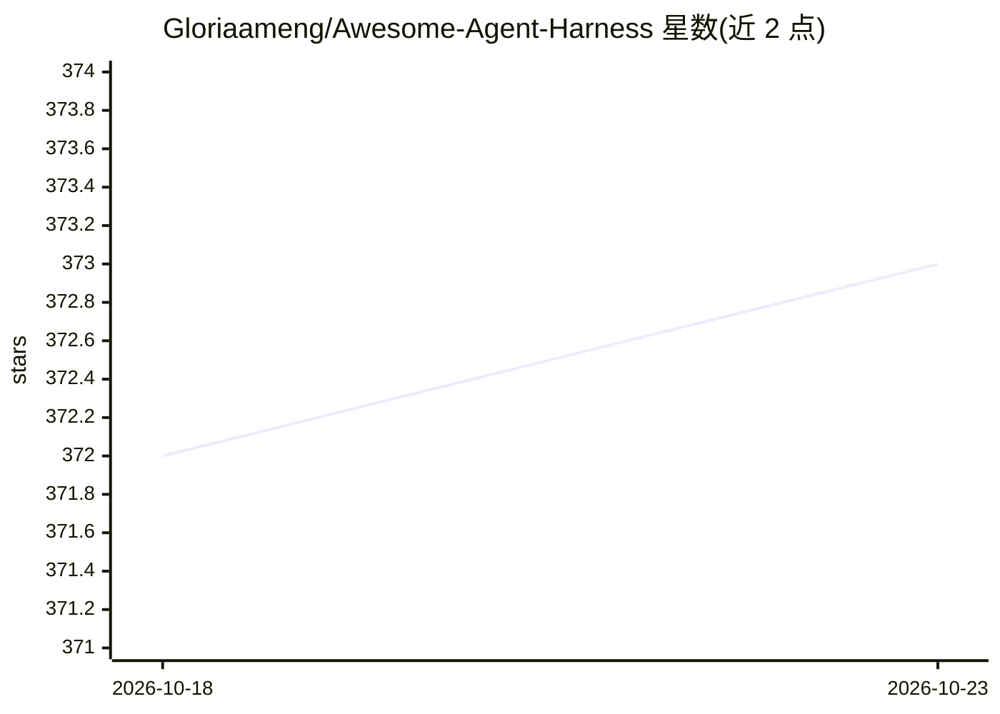

# Gloriaameng/Awesome-Agent-Harness

⭐ 373 · CC-BY-4.0 · 推送 2026-10-22 · [GitHub](https://github.com/Gloriaameng/Awesome-Agent-Harness) · 组织维护 · 中文 README

**LLM Agent Harness 综述论文仓库：168 篇文献证据索引**

论文《Agent Harness for Large Language Model Agents: A Survey》的官方仓库，含持续维护的证据索引。提出模型—harness—环境三层的分析单元与 ETCSLV 六组件框架（执行循环、工具注册、上下文、状态、生命周期、评估），以同一证据编码矩阵比较 34 个系统（含 Claude Code、Codex 等四个锚定案例），收录 30 个 harness 基准与 168 篇文献。面向研究者的综述资源，非可安装软件。

## 筛选速览

| 维度 | 判定 | 备注 |
|---|---|---|
| AI 角色 | `ai-knowledge` | 知识聚合/清单类 |
| 许可风险 | `viral` | CC-BY-4.0 |
| 部署形态 | `None` |  |
| 模型依赖 | — | README 未给出锁定关系 |
| 硬件要求 | — | 无带数字的原话,不猜 |
| 安装摩擦 | `low` | 无编译、无系统依赖或容器化 |
| 成熟度 | — | 结构信号不足 |

## 能力要点

- ETCSLV 六组件分析框架组织 harness 功能
- 34 个系统的统一证据编码比较矩阵
- 168 篇文献与 30 个 harness 基准的证据索引
- 四个锚定系统（Claude Code/Codex/DeepSeek Harness/OpenClaw）深度分析

## 适用场景

- 研究 agent harness 架构时获取系统化的比较矩阵
- 查找 harness 评估基准与相关论文
- 理解模型—harness—环境配置对 agent 行为的影响

## 场景标签

`精选清单` `科研工具` · 领域:学习与行业

## 证据(README 行号)

> L13: This is the official repository for **_Agent Harness for Large Language Model Agents: A Survey_**. The paper is the
> L41: 4. **A comparable system landscape.** Thirty-four systems are assessed with the same evidence-coded component matri
> L62: |What evidence supports each engineering problem?|5. Research Library|168 papers, specifications, architecture note

## 星数曲线

2026-10-18 372 → 2026-10-23 373（+1）

---
*卡片 v1 · prompt 1.4 · 生成 2026-10-22 · 置信度 high · 依据 README sha `be91f2024a83` · [字段定义](../../DATASET.md)*
