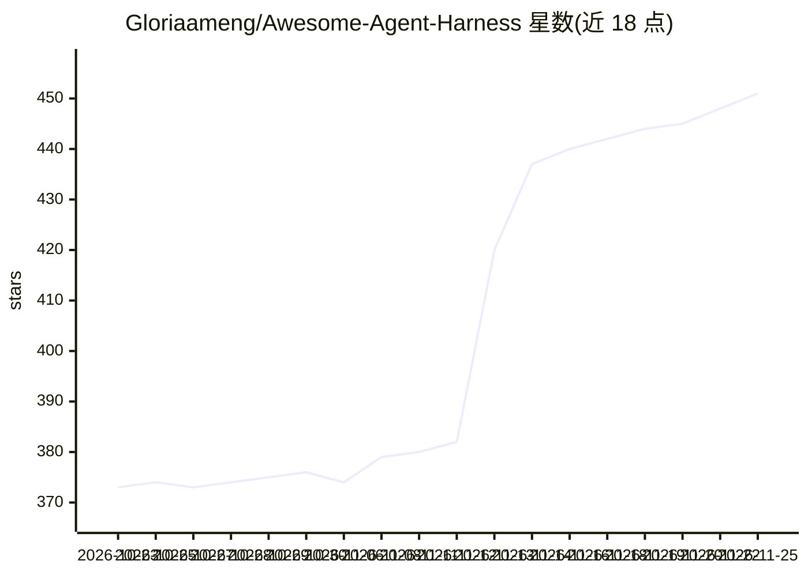

# Gloriaameng/Awesome-Agent-Harness

⭐ 451 · Python · CC-BY-4.0 · 推送 2026-11-20 · [GitHub](https://github.com/Gloriaameng/Awesome-Agent-Harness) · 个人维护 · 中文 README

**LLM agent harness 专题综述论文与资源索引库**

一篇聚焦 LLM agent harness（运行时外壳层）的综述论文的官方仓库：提出 ETCSLV 分析框架（执行、工具、上下文、状态、生命周期、评估），梳理从测试 harness、RL 环境到当代 agent 运行时的历史脉络；以同一证据编码矩阵比较 34 个系统（Claude Code、Codex、DeepSeek Harness、OpenClaw 为锚例），收录 30 条 harness 评测条目与 168 篇文献。仓库作为论文的证据索引层持续更新，含 BibTeX 引用与版本说明（v4 在库、v5 修订中）。

## 筛选速览

| 维度 | 判定 | 备注 |
|---|---|---|
| AI 角色 | `ai-knowledge` | 知识聚合/清单类 |
| 许可风险 | `viral` | CC-BY-4.0 |
| 部署形态 | `None` |  |
| 模型依赖 | — | README 未给出锁定关系 |
| 硬件要求 | — | 无带数字的原话,不猜 |
| 安装摩擦 | `low` | 无编译、无系统依赖或容器化 |
| 成熟度 | — | 结构信号不足 |

## 能力要点

- ETCSLV 六函数分析框架（E/T/C/S/L/V）
- 34 系统证据编码比较矩阵与 4 个锚例深析
- 168 篇文献按工程问题组织的研究库
- 30 条 harness 直接评测基准的评估图谱

## 适用场景

- 研究 agent harness 架构设计与评测方法
- 为 agent 系统选型查找证据编码的比较矩阵
- 引用该综述的 DOI 与 BibTeX 用于学术写作

## 场景标签

`模型评测` `精选清单` `科研工具` · 领域:评测与运维

## 证据(README 行号)

> L3: # Agent Harness for Large Language Model Agents: A Survey
> L22: This is the official repository for **_Agent Harness for Large Language Model Agents: A Survey_**. The paper is the
> L71: |What evidence supports each engineering problem?|5. Research Library|168 papers, specifications, architecture note

## 星数曲线

2026-10-23 373 → 2026-11-25 451（+78）

---
*卡片 v1 · prompt 1.4 · 生成 2026-11-25 · 置信度 high · 依据 README sha `d7dd434589a2` · [字段定义](../../DATASET.md)*
