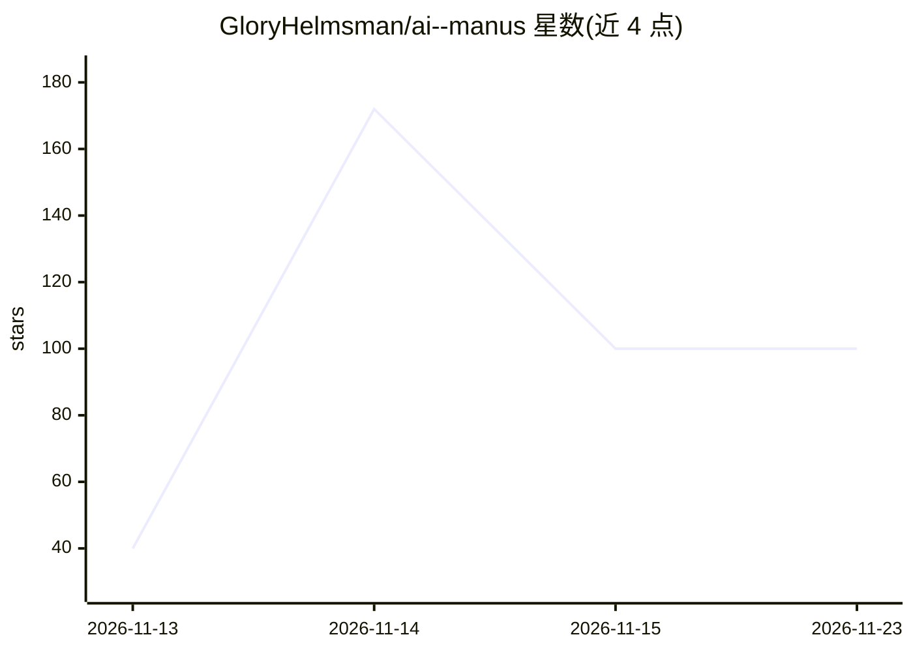

# GloryHelmsman/ai--manus

⭐ 100 · Apache-2.0 · 推送 2026-11-15 · [GitHub](https://github.com/GloryHelmsman/ai--manus) · 个人维护

**面向个人用户的自主 AI Agent：自动执行代码与浏览器操作**

自述为通用型自主 AI Agent 系统，在沙箱环境中运行各类工具：自主编写并执行脚本、控制浏览器（导航网页、填表、采集信息）、执行多步骤日常任务。定位为家庭、学习与轻量办公场景的个人助手，非企业平台。README 提供最低 4GB 内存等兼容性表与使用步骤说明，但未给出任何安装命令、代码结构、模型接入方式或仓库内容说明，且含 'PROMO2026' 下载推广字样，技术细节缺失。

## 筛选速览

| 维度 | 判定 | 备注 |
|---|---|---|
| AI 角色 | `ai-native` | 本体是模型或模型工具 |
| 许可风险 | `permissive` | Apache-2.0 |
| 部署形态 | `None` |  |
| 模型依赖 | — | README 未给出锁定关系 |
| 硬件要求 | — | 无带数字的原话,不猜 |
| 安装摩擦 | `low` | 无编译、无系统依赖或容器化 |
| 成熟度 | — | 结构信号不足 |

## 能力要点

- 自主执行代码完成任务，无需逐步人工操作
- 浏览器控制：导航网页、填写表单、采集信息
- 代码与浏览器操作可在同一任务流中衔接
- 面向家庭/学习/轻量办公的小规模场景

## 适用场景

- 让 Agent 代为执行重复性的脚本与网页操作
- 研究中收集资料、整理笔记、运行小型计算
- 多页面信息采集与轻量报告准备

## 场景标签

`AI 助手` `浏览器自动化` · 领域:效率与自动化

## 证据(README 行号)

> L10: - **Autonomous Code Execution:** Manus AI agent runs code on its own to complete tasks, so you can focus on decisio
> L18: Manus is an autonomous AI agent designed to run code and control a browser on your behalf. Instead of acting like a

## 星数曲线

2026-11-13 40 → 2026-11-23 100（+60）

---
*卡片 v1 · prompt 1.4 · 生成 2026-11-17 · 置信度 low · 依据 README sha `a3d88e202bf0` · [字段定义](../../DATASET.md)*
