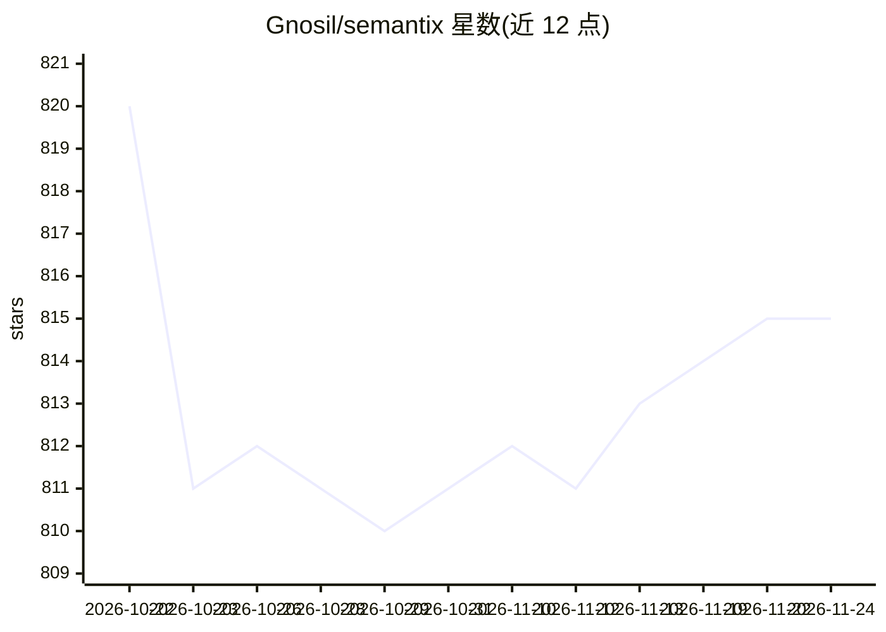

# Gnosil/semantix

⭐ 815 · Go · MIT · 推送 2026-11-24 · [GitHub](https://github.com/Gnosil/semantix) · [官网](https://semantix.ensureok.ai) · 个人维护 · 中文 README

**为 AI 编码代理提供跨会话记忆内核与复用网关**

Semantix 由两部分组成：一个内置记忆内核的 CLI 编码代理，以及可挂接到现有代理的独立记忆内核。内核从已完成会话中抽取可复用的 slices（任务模式、项目知识、工具序列与结果）存入本地评分库，在相似任务出现时重新注入，并分三层复用：provider 前缀缓存维护、上下文复用（L2）、经有效性校验的结果复用（L3，fail-closed）。默认检索为本地 BM25，无需向量库或嵌入服务；提供网关模式，面向 OpenAI 兼容 Chat Completions 客户端。测量数据标注为回放/演示结果而非生产基准。

## 筛选速览

| 维度 | 判定 | 备注 |
|---|---|---|
| AI 角色 | `ai-ecosystem` | LLM/agent 周边工具 |
| 许可风险 | `permissive` | MIT |
| 部署形态 | `None` |  |
| 模型依赖 | — | README 未给出锁定关系 |
| 硬件要求 | — | 无带数字的原话,不猜 |
| 安装摩擦 | `low` | 无编译、无系统依赖或容器化 |
| 成熟度 | — | 结构信号不足 |

## 能力要点

- 跨会话 slice 抽取、评分与重注入，命中带检索分区（hit/grey/miss）与来源会话
- L3 结果复用基于 mtime 与 SHA-256 指纹做依赖有效性检查，失败即拒绝缓存结果
- 网关前缀清理：剥离归属/计费标记行并按名排序工具数组以减少前缀失效
- 默认本地 BM25 检索，向量与混合检索可选；提供 docker-compose 的 Milvus 可选栈

## 适用场景

- 新会话重复项目探索时复用此前会话积累的项目知识与工具序列
- 通过网关接入 OpenAI 兼容客户端以减少前缀缓存失效
- 为自托管代理注册 semantix_lookup/semantix_inject 工具接入记忆内核
- 用 verify/dashboard 对已抽取会话做回放验证与快照查看

## 场景标签

`Agent 记忆` `编码 Agent` · 领域:Agent 开发

## 证据(README 行号)

> L17: > Semantix addresses both: a complete coding agent with the memory kernel built in, and a standalone kernel that at
> L39: **`semantix-agent` — the complete agent.** A CLI coding agent shipping with the memory kernel built in: extraction,
> L41: **The kernel — attached to an existing agent.** Harness-independent by design; the integration surface is a small s

## 星数曲线

2026-10-22 820 → 2026-11-24 815（-5）

---
*卡片 v1 · prompt 1.4 · 生成 2026-11-24 · 置信度 high · 依据 README sha `ebe587752914` · [字段定义](../../DATASET.md)*
