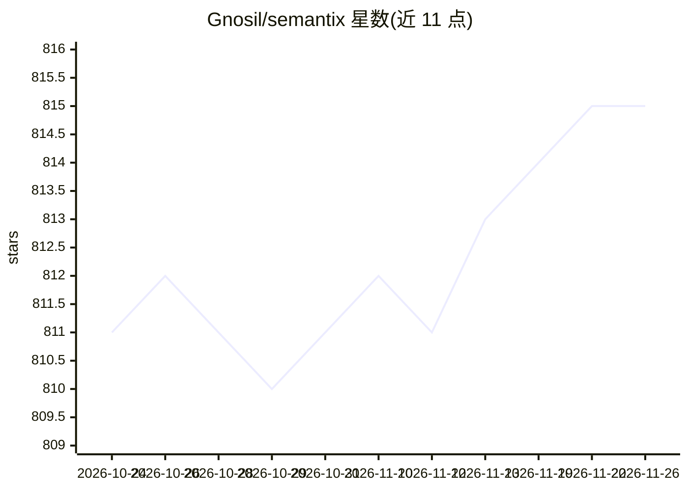

# Gnosil/semantix

⭐ 815 · Go · MIT · 推送 2026-11-24 · [GitHub](https://github.com/Gnosil/semantix) · [官网](https://semantix.ensureok.ai) · 个人维护 · 中文 README

**为 AI 编码代理提供跨会话记忆复用与缓存优化的内核**

Semantix 由两部分组成：内置记忆内核的 CLI 编码代理（semantix-agent，含约 50 个端点的 provider 预设），以及可挂接到既有代理的独立内核，通过 agent skill、工具注册或 OpenAI 兼容网关三种方式集成。它从已完成会话中抽取可复用切片（任务模式、项目知识、工具序列与结果）存入本地评分库，在相似任务出现时重新注入；默认检索为本地 BM25，无需向量数据库或嵌入服务。结果复用经相关性、隔离与有效性检查，失败时回退正常执行路径。README 注明现有证据为重放/演示测量，非生产基准。

## 筛选速览

| 维度 | 判定 | 备注 |
|---|---|---|
| AI 角色 | `ai-ecosystem` | LLM/agent 周边工具 |
| 许可风险 | `permissive` | MIT |
| 部署形态 | `None` |  |
| 模型依赖 | — | README 未给出锁定关系 |
| 硬件要求 | — | 无带数字的原话,不猜 |
| 安装摩擦 | `low` | 无编译、无系统依赖或容器化 |
| 成熟度 | — | 结构信号不足 |

## 能力要点

- 从历史会话提取切片并按命中区（hit/grey/miss）分级注入
- 网关前缀卫生：剥离归因标记、按名排序工具以保留 provider 前缀缓存
- L3 结果复用用 mtime 与 SHA-256 校验依赖文件，fail-closed
- 调度器学习工具使用模式，在模型等待期并行调用与只读预取

## 适用场景

- 让编码代理在新会话中复用上个会话的项目知识与工具序列
- 给 OpenAI 兼容客户端加网关以提高 prompt-cache 命中率
- 为自托管代理通过工具 schema 挂接跨会话记忆

## 场景标签

`Agent 记忆` `编码 Agent` · 领域:Agent 开发

## 证据(README 行号)

> L39: **`semantix-agent` — the complete agent.** A CLI coding agent shipping with the memory kernel built in: extraction,
> L41: **The kernel — attached to an existing agent.** Harness-independent by design; the integration surface is a small s
> L49: Memory integration is designed to fail open: on kernel error the agent falls back to its normal execution path. Dir

## 星数曲线

2026-10-24 811 → 2026-11-26 815（+4）

---
*卡片 v1 · prompt 1.4 · 生成 2026-11-25 · 置信度 high · 依据 README sha `f360ea181a2e` · [字段定义](../../DATASET.md)*
