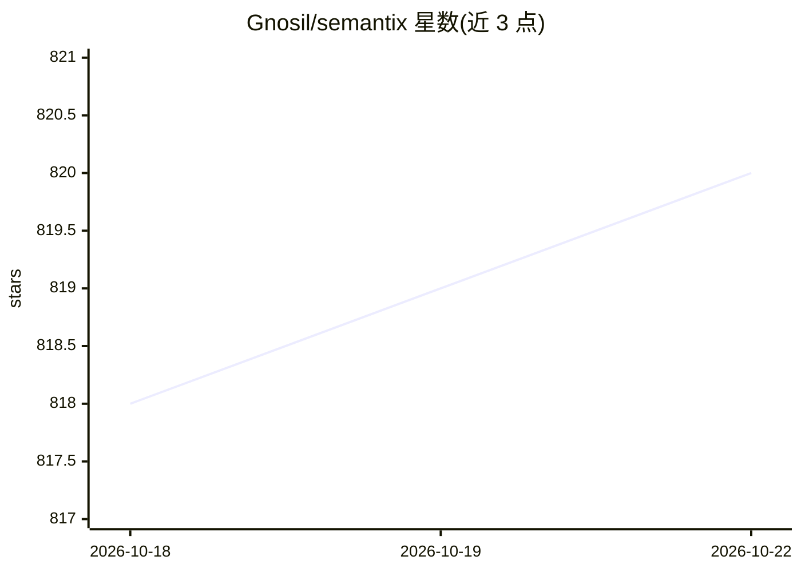

# Gnosil/semantix

⭐ 811 · Go · MIT · 推送 2026-10-21 · [GitHub](https://github.com/Gnosil/semantix) · [官网](https://semantix.ensureok.ai) · 组织维护 · 中文 README

**AI 编码代理的跨会话记忆内核与语义缓存层，降低调用成本**

由两部分组成：内置记忆内核的 CLI 编码代理 semantix-agent，以及可挂接到既有代理（Claude Code、LangChain、任意 OpenAI 兼容客户端等）的独立内核。机制包括：从结束会话中抽取可复用 slices 存入本地打分库并在相似任务出现时重注入；字节稳定注入与前缀卫生中间件以提升 provider 前缀缓存命中率；L3 结果复用可直接返回已验证结果而跳过模型调用；调度器学习工具使用模式做并行与预取。测试数据标注为 replay/demo 测量而非生产基准，真实会话验证为 v1.0 开放门槛。

## 筛选速览

| 维度 | 判定 | 备注 |
|---|---|---|
| AI 角色 | `ai-ecosystem` | LLM/agent 周边工具 |
| 许可风险 | `permissive` | MIT |
| 部署形态 | `None` |  |
| 模型依赖 | — | README 未给出锁定关系 |
| 硬件要求 | — | 无带数字的原话,不猜 |
| 安装摩擦 | `low` | 无编译、无系统依赖或容器化 |
| 成熟度 | `idea` | |

## 能力要点

- 跨会话记忆：抽取 slices→本地打分库→相似任务重注入（hit/grey/miss 分区标注）
- 字节稳定注入、前缀卫生中间件与 per-vendor 缓存 TTL 表提升前缀缓存命中率
- L3 结果复用可跳过模型调用直接返回已验证结果
- Fail-open 设计：内核出错时代理回落到正常执行路径

## 适用场景

- 让编码代理在新会话中保留项目的构建约定、测试布局等知识
- 通过网关或工具注册给 Claude Code / 自托管代理挂接记忆内核
- 降低第三方端点下的缓存失效与 token 开销

## 场景标签

`Agent 记忆` `编码 Agent` · 领域:Agent 开发

## 证据(README 行号)

> L17: > Semantix addresses both: a complete coding agent with the memory kernel built in, and a standalone kernel that at
> L41: **The kernel — attached to an existing agent.** Harness-independent by design; the integration surface is a small s
> L117: |Any OpenAI-compatible client|`semantix-gateway` in front, custom base URL|✅ shipped|

## 星数曲线

2026-10-18 818 → 2026-10-22 820（+2）

---
*卡片 v1 · prompt 1.4 · 生成 2026-10-21 · 置信度 high · 依据 README sha `2cbf30edbddb` · [字段定义](../../DATASET.md)*
