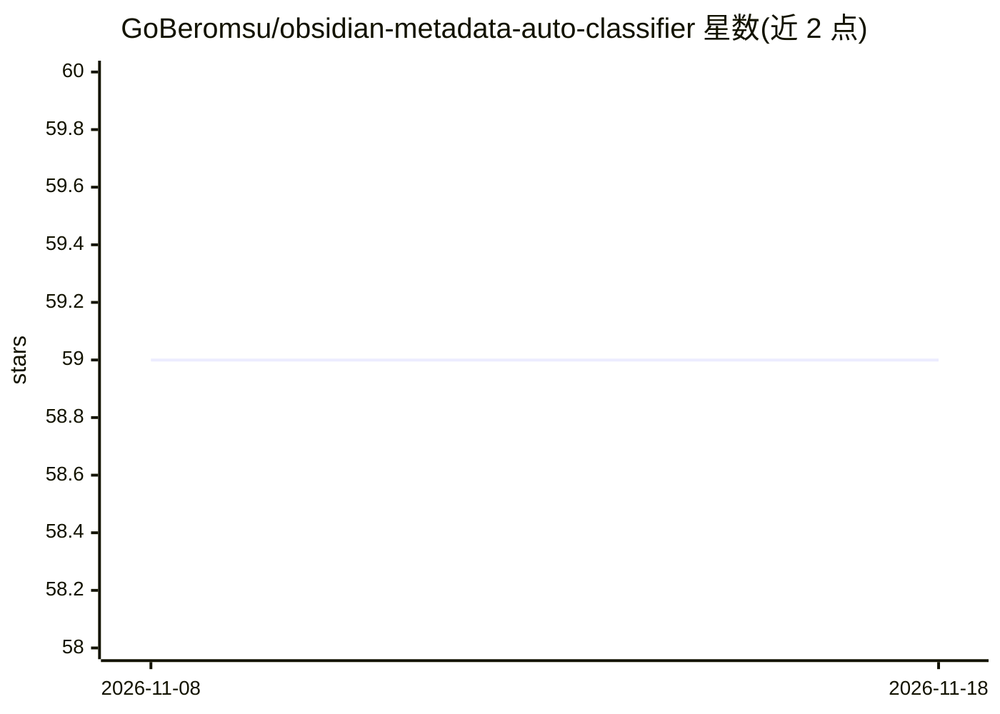

# GoBeromsu/obsidian-metadata-auto-classifier

⭐ 59 · TypeScript · MIT · 推送 2026-11-04 · [GitHub](https://github.com/GoBeromsu/obsidian-metadata-auto-classifier) · 个人维护

**Obsidian 插件：用 AI 决策模型为笔记自动分类标签与 frontmatter**

面向 Obsidian 用户的笔记元数据插件：从笔记既有标签和 frontmatter 候选值中做带概率的 yes/no 判定，仅写入高置信结果；分类仅使用决策 API 模型（TypeSafe Jev、OpenAI Decisions、OpenRouter 或自定义端点），聊天模型（Anthropic、Gemini、Ollama 等）只用于显式开启时生成新标签。支持 10 种 provider 配置，本地 Ollama 和 LM Studio 可免 key。写入保留无关 frontmatter 与正文，无遥测。通过社区插件市场或手动放入插件目录安装。

## 筛选速览

| 维度 | 判定 | 备注 |
|---|---|---|
| AI 角色 | `ai-native` | 本体是模型或模型工具 |
| 许可风险 | `permissive` | MIT |
| 部署形态 | `None` |  |
| 模型依赖 | local-ok | 支持本地模型 |
| 硬件要求 | — | 无带数字的原话,不猜 |
| 安装摩擦 | `low` | 无编译、无系统依赖或容器化 |
| 成熟度 | — | 结构信号不足 |

## 能力要点

- 候选值逐一给出概率、仅写入高置信 yes 的校准式分类
- 分类与生成分离：决策 API 模型做分类，聊天模型仅生成新标签
- 支持 TypeSafe/OpenAI/Anthropic/Gemini/OpenRouter/Ollama/DeepSeek/LM Studio 等 provider
- 本地 Ollama 与 LM Studio 可免 API key 使用

## 适用场景

- 为 Obsidian 笔记批量归类既有标签与 frontmatter 属性
- 在受控候选值范围内做高置信度自动打标
- 用本地模型（Ollama/LM Studio）免 key 分类笔记元数据

## 场景标签

`知识库管理` · 领域:知识与检索

## 证据(README 行号)

> L3: Automatically classifies and applies metadata to your notes.
> L9: - Selects existing values for tags and other frontmatter fields with calibrated yes/no decisions: each candidate get
> L10: - Classification uses decision API models only: TypeSafe Jev, OpenAI Decisions, OpenRouter or a custom `/systemone`

## 星数曲线

2026-11-08 59 → 2026-11-18 59（+0）

---
*卡片 v1 · prompt 1.4 · 生成 2026-11-18 · 置信度 high · 依据 README sha `00139d507fcb` · [字段定义](../../DATASET.md)*
