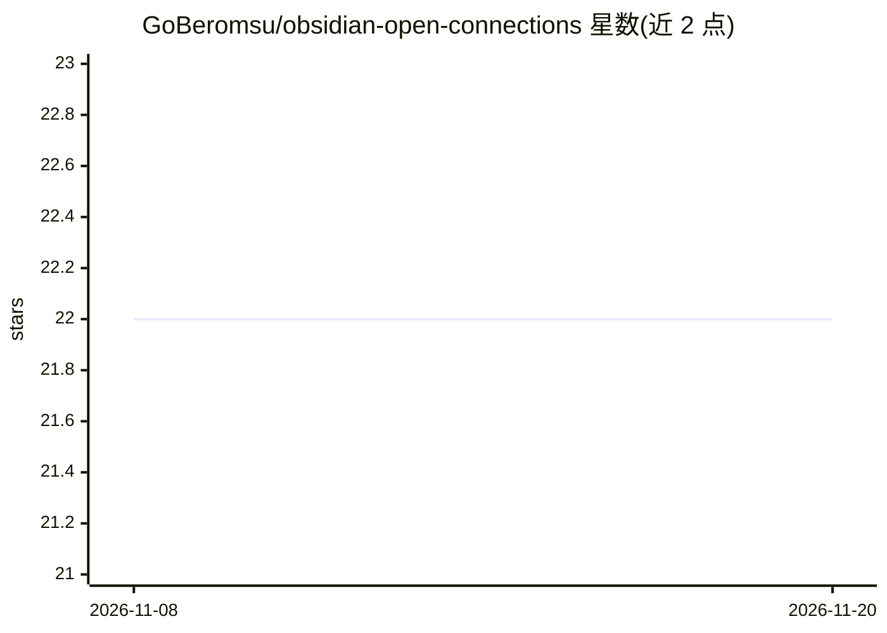

# GoBeromsu/obsidian-open-connections

⭐ 22 · TypeScript · GPL-3.0 · 推送 2026-11-04 · [GitHub](https://github.com/GoBeromsu/obsidian-open-connections) · 个人维护

**Obsidian 插件：本地或 API 嵌入的语义关联笔记与语义搜索**

面向 Obsidian 用户的笔记语义工具：Connections 视图按相似度列出与当前笔记语义相关的笔记，Lookup 视图支持按含义而非关键词搜索全库。默认使用 Transformers.js 本地嵌入（WebGPU，WASM 回退），也可切换 OpenAI、Gemini、Ollama、LM Studio、Upstage、OpenRouter 等 API 提供商；嵌入缓存于本地并在换模型时自动重建。附带可选 MCP 服务器，将库内关联暴露给 MCP 客户端，仅监听 127.0.0.1。仅支持桌面端，需 Obsidian 1.13.0+。

## 筛选速览

| 维度 | 判定 | 备注 |
|---|---|---|
| AI 角色 | `ai-enhanced` | 去掉 AI 部分产品仍成立 |
| 许可风险 | `viral` | GPL-3.0 |
| 部署形态 | `None` |  |
| 模型依赖 | local-ok | 支持本地模型 |
| 硬件要求 | — | 无带数字的原话,不猜 |
| 安装摩擦 | `low` | 无编译、无系统依赖或容器化 |
| 成熟度 | — | 结构信号不足 |

## 能力要点

- Connections 视图实时列出与当前笔记语义相关的笔记
- 默认本地嵌入（Transformers.js + WebGPU，WASM 回退），无需 API key
- 支持 OpenAI/Gemini/Ollama/LM Studio/Upstage/OpenRouter 等嵌入提供商
- 可选 MCP 服务器向 MCP 客户端暴露库内关联

## 适用场景

- 浏览笔记时发现语义相关的内容与隐性关联
- 用自然语言按含义检索整个笔记库
- 把 Obsidian 笔记关联接入 MCP 客户端工作流

## 场景标签

`知识库管理` `语义搜索` · 领域:知识与检索

## 证据(README 行号)

> L9: - Connections view lists notes related in meaning to the note you have open, and updates as you navigate.
> L11: - Local embeddings by default (Transformers.js with WebGPU, WASM fallback), or OpenAI, Gemini, Ollama, LM Studio, U

## 星数曲线

2026-11-08 22 → 2026-11-20 22（+0）

---
*卡片 v1 · prompt 1.4 · 生成 2026-11-18 · 置信度 high · 依据 README sha `4d02d77998bd` · [字段定义](../../DATASET.md)*
