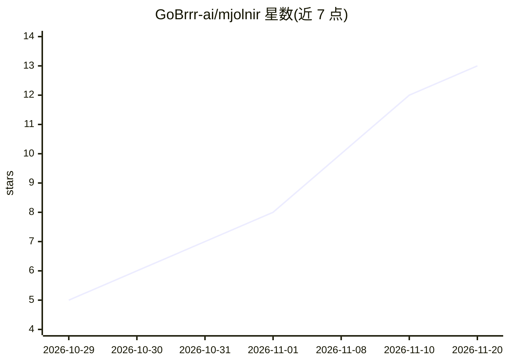

# GoBrrr-ai/mjolnir

⭐ 13 · Python · Apache-2.0 · 推送 2026-11-17 · [GitHub](https://github.com/GoBrrr-ai/mjolnir) · [官网](https://gobrrr-ai.github.io/mjolnir/) · 组织维护

**为边缘 GPU 提供 LLM 推理加速的解码内核与调优 vLLM 镜像**

面向边缘 GPU 的 LLM 推理服务工具集，由四部分组成：按芯片定制解码注意力内核（Thor 的 CuTe DSL、Orin 的 mma.sync）、6-bit e2m3 KV cache、携带全部内核的补丁版 vLLM 镜像，以及一个统一 CLI（serve/bench/verify/calibrate/plot）。模型以 YAML 配置文件描述，基准数据以原始 JSON 发布可复现。限定运行于 Jetson AGX Thor、Jetson Orin 与 DGX Spark 三类平台，需 Docker 与 NVIDIA Container Toolkit。

## 筛选速览

| 维度 | 判定 | 备注 |
|---|---|---|
| AI 角色 | `ai-ecosystem` | LLM/agent 周边工具 |
| 许可风险 | `permissive` | Apache-2.0 |
| 部署形态 | `self-host` | docker 或自建部署 |
| 模型依赖 | local-ok | 支持本地模型 |
| 硬件要求 | — | 无带数字的原话,不猜 |
| 安装摩擦 | `low` | 无编译、无系统依赖或容器化 |
| 成熟度 | — | 结构信号不足 |

## 能力要点

- 按平台定制的解码注意力内核（tcgen05/mma.sync）
- 6-bit e2m3 KV cache，同等显存容纳更多 token
- 补丁版 vLLM Docker 镜像与统一 CLI（serve/bench/verify/calibrate/plot）
- 模型即 YAML 配置文件，基准可复现并输出原始 JSON

## 适用场景

- 在 Jetson 或 DGX Spark 上部署本地 LLM 服务
- 对同一模型的不同内核/量化配置做 A/B 基准对比
- 边缘设备上以更少显存运行更长上下文

## 场景标签

`推理引擎` · 领域:训练与推理

## 证据(README 行号)

> L13:  Mjölnir — faster, bigger-context LLM serving on edge GPUs : a dedicated decode kernel per platform, a tuned vLLM i
> L27: **Mjolnir makes LLM serving on edge GPUs faster and roomier.** It is four things:
> L82: > Requirements: a supported board — Jetson AGX Thor (JetPack 7.x), Jetson Orin (JetPack 7.2.1+) or DGX Spark (DGX O

## 星数曲线

2026-10-29 5 → 2026-11-20 13（+8）

---
*卡片 v1 · prompt 1.4 · 生成 2026-11-18 · 置信度 high · 依据 README sha `6f8453d87a1f` · [字段定义](../../DATASET.md)*
