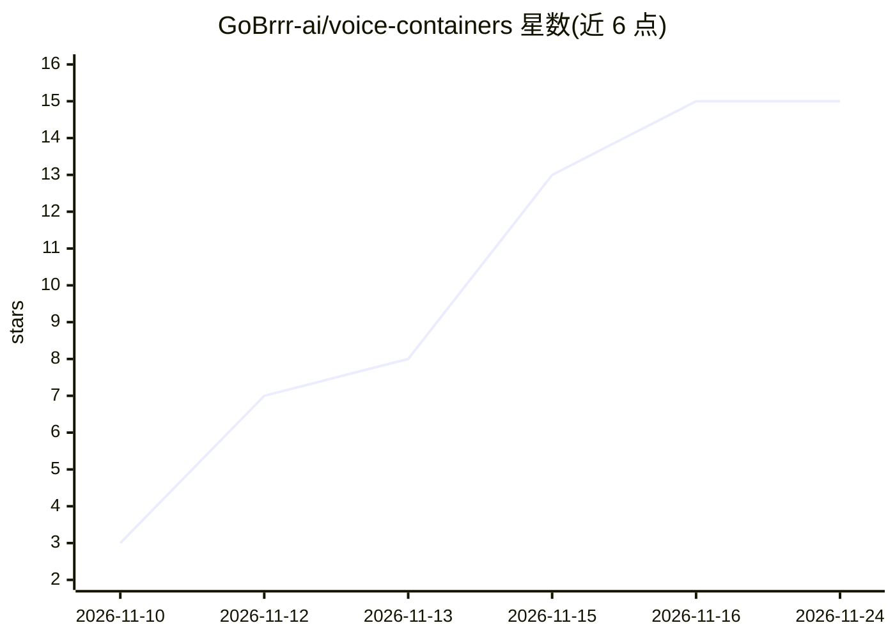

# GoBrrr-ai/voice-containers

⭐ 15 · Python · Apache-2.0 · 推送 2026-11-21 · [GitHub](https://github.com/GoBrrr-ai/voice-containers) · 组织维护

**面向 Jetson 边缘 GPU 的语音识别与合成 Docker 镜像集**

为 NVIDIA Jetson AGX Orin（sm_87）与 AGX Thor（sm_110a）提供的生产级语音容器镜像集合：包含 10 个语音识别引擎（Parakeet、Whisper、Canary、Moonshine、Nemotron 等）与 5 个语音合成引擎（Kokoro、Piper、Phonon、Paradee、Pocket），每个引擎一个 Docker 镜像，同一镜像含两种架构的 cubin，基于 CUDA 13.2 / JetPack 7.2.1。所有语音镜像暴露 OpenAI 兼容的 /v1/audio/* API，支持 SSE 部分结果与分块 PCM 流式输出、Wyoming 协议（Home Assistant）。附带规格驱动的基准评测框架，在 LibriSpeech 固定清单上测量 WER、延迟、RTF、内存与功耗，并给出带硬性门槛的部署评分。构建方式为每个项目一个 Dockerfile + 一个脚本（make build-all），无框架依赖。

## 筛选速览

| 维度 | 判定 | 备注 |
|---|---|---|
| AI 角色 | `ai-native` | 本体是模型或模型工具 |
| 许可风险 | `permissive` | Apache-2.0 |
| 部署形态 | `self-host` | docker 或自建部署 |
| 模型依赖 | — | README 未给出锁定关系 |
| 硬件要求 | — | 无带数字的原话,不猜 |
| 安装摩擦 | `low` | 无编译、无系统依赖或容器化 |
| 成熟度 | — | 结构信号不足 |

## 能力要点

- 10 个 STT 引擎与 5 个 TTS 引擎，每引擎独立 Docker 镜像，单一镜像同时服务 Orin 与 Thor
- OpenAI 兼容 /v1/audio/* API，CI 测试线协议；SSE 流式部分结果与分块 PCM，另支持 Wyoming 协议
- 规格驱动的基准评测：WER/延迟 p95/RTF/VRAM 加权评分，独立硬性门槛（延迟>1.5s 或内存>4GiB 判不可部署）
- 纯 Docker 构建，每项目一个 Dockerfile + 一个脚本，make build-all 全量本地构建

## 适用场景

- 在 Jetson 边缘设备上部署流式语音识别与合成服务
- 用 OpenAI SDK 直接调用边缘语音容器的 /v1/audio/* 接口
- 对比多个 STT/TTS 引擎在边缘硬件上的延迟、内存与功耗表现
- 为 Home Assistant 通过 Wyoming 协议接入本地语音栈

## 场景标签

`语音识别` `语音合成` · 领域:内容生成

## 证据(README 行号)

> L10:  Production-ready voice-container images for NVIDIA Jetson edge GPUs — a full streaming
> L24:  🎙️&nbsp;10 speech-recognition engines
> L33:  🔌&nbsp;OpenAI-compatible API

## 星数曲线

2026-11-10 3 → 2026-11-24 15（+12）

---
*卡片 v1 · prompt 1.4 · 生成 2026-11-18 · 置信度 high · 依据 README sha `b0374fd1c3b7` · [字段定义](../../DATASET.md)*
