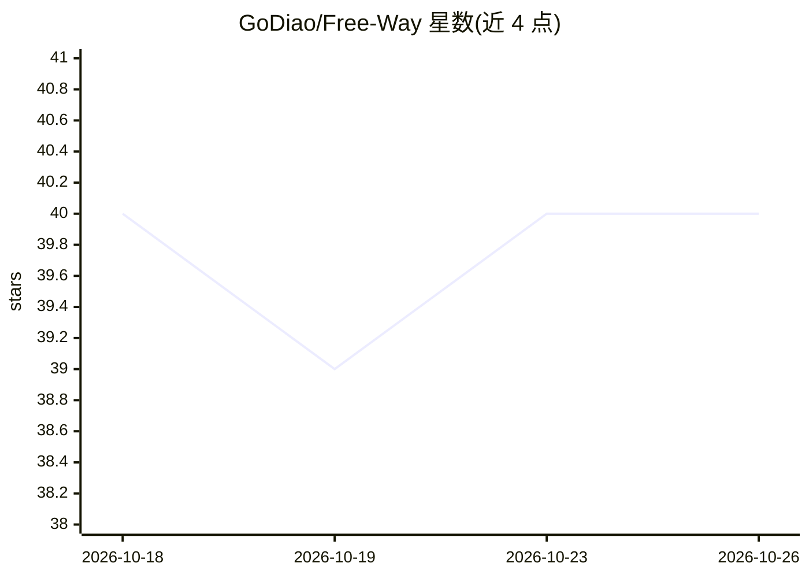

# GoDiao/Free-Way

⭐ 40 · TypeScript · MIT · 推送 2026-08-18 · [GitHub](https://github.com/GoDiao/Free-Way) · [官网](https://godiao.github.io/Free-Way/) · 个人维护 · 中文 README

**本地 LLM 网关：让编码工具免费使用多家免费层模型**

Node.js 编写的本地 API 网关，在 localhost:8787 同时暴露 OpenAI 与 Anthropic 兼容端点，将 Claude Code、OpenCode、Continue、Cline 等客户端的请求路由到 14 家免费层 LLM 提供商（OpenRouter、Groq、GitHub Models、Cloudflare、SiliconFlow、智谱等），自带密钥管理、模型目录刷新、健康检查与浏览器控制台。BYOK 模式，密钥留在本机，不含共享密钥池；提供商限流或不可用时自动回退到其他路由。通过 npx 或 npm 全局安装运行。

## 筛选速览

| 维度 | 判定 | 备注 |
|---|---|---|
| AI 角色 | `ai-ecosystem` | LLM/agent 周边工具 |
| 许可风险 | `permissive` | MIT |
| 部署形态 | `library` | 以包/库形式分发 |
| 模型依赖 | locked-api |  |
| 硬件要求 | — | 无带数字的原话,不猜 |
| 安装摩擦 | `low` | 无编译、无系统依赖或容器化 |
| 成熟度 | — | 结构信号不足 |

## 能力要点

- 单端点同时提供 OpenAI 与 Anthropic 兼容 API（/v1/chat/completions、/v1/messages）
- 接入 14 家免费层提供商并支持限流回退路由
- 本地 Web 控制台：配置密钥、浏览模型、健康检查、测试请求
- 运行时密钥管理，支持 FREEWAY_API_KEY 网关鉴权

## 适用场景

- 让 Claude Code/OpenCode 等编码工具统一接入免费层模型
- 在多家免费提供商之间自动回退，减少限流中断
- 本地集中管理多家提供商的 API 密钥

## 场景标签

`模型网关` · 领域:Agent 开发

## 证据(README 行号)

> L22:  One localhost gateway for OpenAI- and Anthropic-compatible tools.
> L99: Free-Way is a local control plane for free LLM APIs. It normalizes protocol differences, resolves models, checks ro

## 星数曲线

2026-10-18 40 → 2026-10-26 40（+0）

---
*卡片 v1 · prompt 1.4 · 生成 2026-10-25 · 置信度 high · 依据 README sha `7a23c2061ce6` · [字段定义](../../DATASET.md)*
