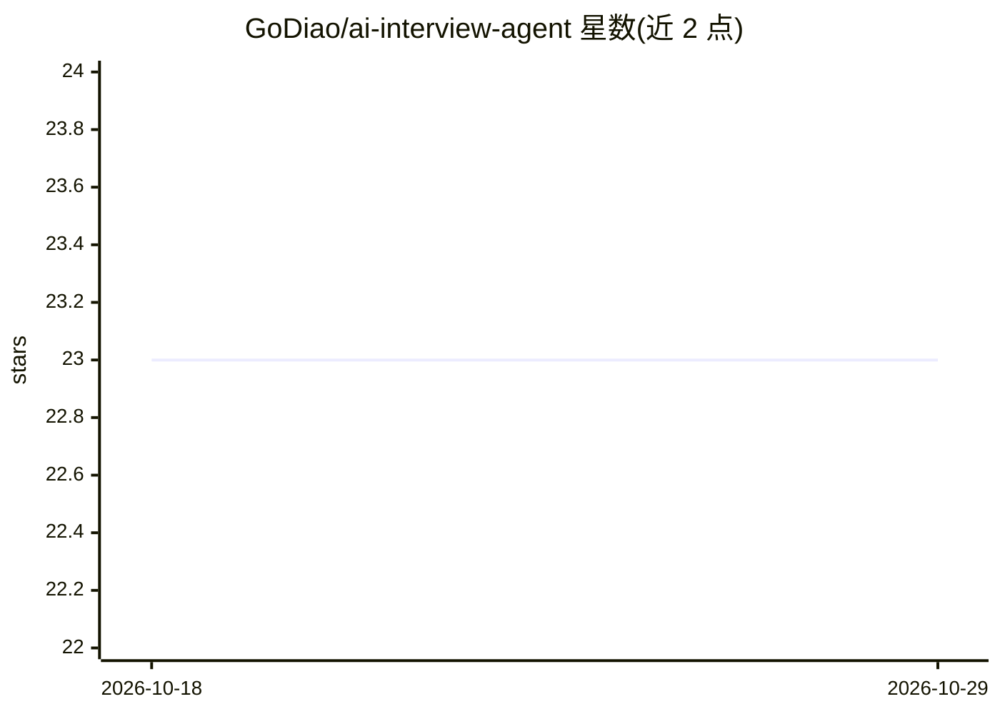

# GoDiao/ai-interview-agent

⭐ 23 · Python · 推送 2026-03-30 · [GitHub](https://github.com/GoDiao/ai-interview-agent) · 个人维护 · 中文 README

**AI 面试系统：生成报告并维护候选人长期成长档案**

基于 FastAPI 的 AI 面试应用，按状态机流程（开场→技术→性格→报告）执行文本优先、语音可选的面试会话，生成结构化报告。核心机制是候选人库（按 name+email 索引）跨会话延续：自动复盘重复/新增/已解决问题，增量更新学习看板，回填独立候选人画像，仪表盘展示分数趋势与问题分布。存储采用按候选人拆分的 JSON 文件架构，LLM 通过 OpenAI 兼容 API 接入，本地运行于 127.0.0.1:8765。

## 筛选速览

| 维度 | 判定 | 备注 |
|---|---|---|
| AI 角色 | `ai-native` | 本体是模型或模型工具 |
| 许可风险 | `none` | — |
| 部署形态 | `None` |  |
| 模型依赖 | — | README 未给出锁定关系 |
| 硬件要求 | — | 无带数字的原话,不猜 |
| 安装摩擦 | `low` | 无编译、无系统依赖或容器化 |
| 成熟度 | — | 结构信号不足 |

## 能力要点

- 状态机面试流程：intro→technical→personality→report
- 候选人库按 name+email 索引，跨会话延续追踪
- 自动会话复盘：重复/新增/已修复问题识别与学习看板更新
- STT 支持 sensevoice_http/local_whisper/iFlytek，TTS 支持 browser/kokoro

## 适用场景

- 对候选人进行多轮技术+性格 AI 面试并生成报告
- 跨会话追踪候选人的问题改进与学习进展
- 通过仪表盘查看候选人评分趋势与经验分布

## 场景标签

 · 领域:招聘/HR 科技

## 证据(README 行号)

> L3: > An AI interview system that does more than generate one-off reports.
> L17: - **Explicit state-machine interview flow**: intro -> technical -> personality -> report.
> L107: - **LLM**: OpenAI-compatible APIs

## 星数曲线

2026-10-18 23 → 2026-10-29 23（+0）

---
*卡片 v1 · prompt 1.4 · 生成 2026-10-27 · 置信度 high · 依据 README sha `b65d2f9e9edb` · [字段定义](../../DATASET.md)*
