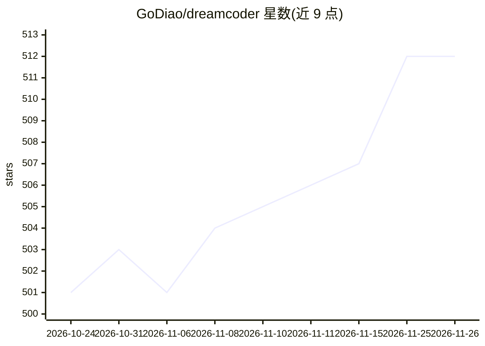

# GoDiao/dreamcoder

⭐ 512 · TypeScript · NOASSERTION · 推送 2026-11-24 · [GitHub](https://github.com/GoDiao/dreamcoder) · [官网](https://godiao.github.io/dreamcoder/) · 个人维护 · 中文 README

**本地运行的多服务商 AI 编程工作台，管理 Claude Code 会话**

桌面端（Electron）+ 本地会话服务的 AI 编程工作台：将模型配置、编码会话、内置终端与工具调用活动整合在一个工作区。用户可配置 Anthropic 或 OpenAI 兼容端点（预置 DeepSeek、Qwen、Kimi、Zhipu GLM、LM Studio、Ollama 等），API key 存本地文件。功能含内置浏览器（agent 可操作页面）、交互式页面/图表生成、60+ 模板与 156+ 设计系统的设计模式、跨会话任务看板、MCP 扩展，以及同局域网内手机浏览器接续桌面会话（H5 Access）。跨网络访问需自建反向代理；Linux 打包尚未提供。

## 筛选速览

| 维度 | 判定 | 备注 |
|---|---|---|
| AI 角色 | `ai-ecosystem` | LLM/agent 周边工具 |
| 许可风险 | `permissive` | NOASSERTION |
| 部署形态 | `desktop` | 安装包/桌面程序 |
| 模型依赖 | local-ok | 支持本地模型 |
| 硬件要求 | — | 无带数字的原话,不猜 |
| 安装摩擦 | `low` | 无编译、无系统依赖或容器化 |
| 成熟度 | `idea` | |

## 能力要点

- 本地运行，API key 与会话数据存于本地文件
- 多服务商配置：Anthropic 与 OpenAI 兼容端点，含连接检测
- agent 在对话中生成可交互页面（40+ G2 图表、流程图、3D 场景等）
- 跨会话项目看板：任务、验收标准、评审流程

## 适用场景

- 在桌面端集中管理多个 AI 编码会话与文件变更
- 配置 DeepSeek/Qwen/Kimi 等国内模型端点做编码工作
- 用 /design 从模板与设计系统生成网页原型并克隆网站
- 同局域网内用手机继续桌面上的编码会话

## 场景标签

`编码 Agent` `代码生成` · 领域:编码与开发

## 证据(README 行号)

> L5: **A locally run, multi-provider AI coding workspace**
> L28: DreamCoder runs its desktop app and session service locally, bringing model configuration, coding sessions, the ter
> L30: * **Choose a model provider**: Configure Anthropic or OpenAI-compatible endpoints. Presets include DeepSeek, Qwen, 

## 星数曲线

2026-10-24 501 → 2026-11-26 512（+11）

---
*卡片 v1 · prompt 1.4 · 生成 2026-11-25 · 置信度 high · 依据 README sha `3c8f552dfed4` · [字段定义](../../DATASET.md)*
