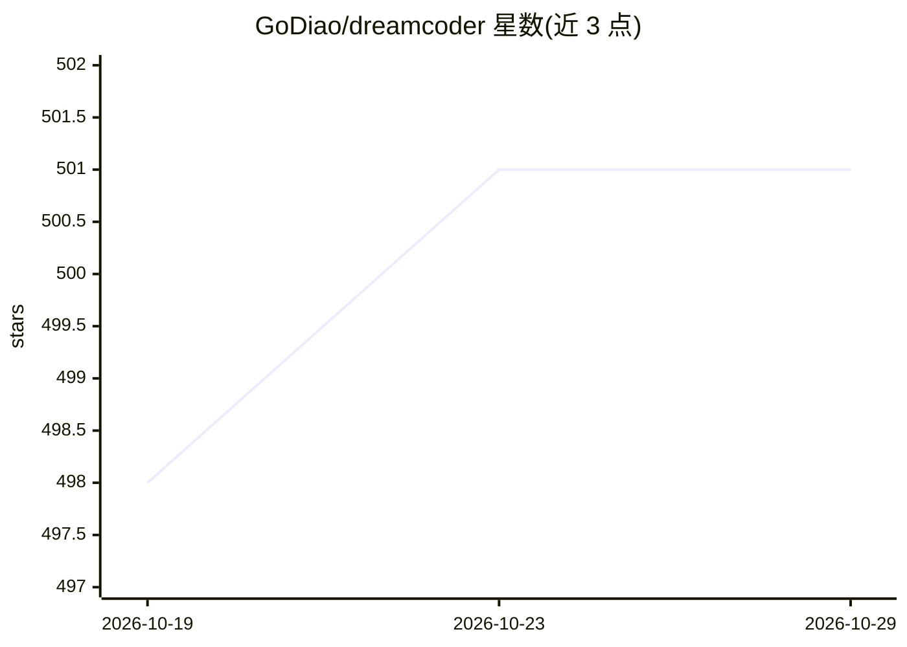

# GoDiao/dreamcoder

⭐ 501 · TypeScript · NOASSERTION · 推送 2026-10-28 · [GitHub](https://github.com/GoDiao/dreamcoder) · [官网](https://godiao.github.io/dreamcoder/) · 个人维护 · 中文 README

**本地运行的多服务商 AI 编程工作台，桌面管理 Claude Code 会话**

基于 Tauri 2 + React 18 + Bun 的桌面应用，将模型配置、编码会话、内置终端（PowerShell/Bash/Zsh）与工具调用统一到一个工作区。支持 Anthropic 及 OpenAI 兼容端点，预置 DeepSeek、Qwen、Kimi、Zhipu GLM、LM Studio、Ollama 等，也可自定义端点；API key 存储在本地文件。提供 Computer Use、MCP 可视化配置，以及同一局域网内通过手机浏览器接续桌面会话的 H5 Access。macOS (Apple Silicon) 与 Windows x64 有安装包（未签名），Linux 为 best-effort。由个人在业余时间维护。

## 筛选速览

| 维度 | 判定 | 备注 |
|---|---|---|
| AI 角色 | `ai-ecosystem` | LLM/agent 周边工具 |
| 许可风险 | `permissive` | NOASSERTION |
| 部署形态 | `desktop` | 安装包/桌面程序 |
| 模型依赖 | local-ok | 支持本地模型 |
| 硬件要求 | — | 无带数字的原话,不猜 |
| 安装摩擦 | `low` | 无编译、无系统依赖或容器化 |
| 成熟度 | — | 结构信号不足 |

## 能力要点

- 多服务商配置：Anthropic / OpenAI 兼容端点 + DeepSeek、Qwen、Ollama 等预置
- 内置 PTY 终端与文件变更、工具调用的可视化审查
- MCP 服务可视化配置与 Computer Use 桌面操作
- H5 Access：同一局域网内用手机浏览器接续桌面会话

## 适用场景

- 在桌面统一管理模型配置与多个编码会话
- 审查编码 agent 的文件改动与终端命令
- 在手机上继续桌面端的编码会话（同局域网）

## 场景标签

`编码 Agent` · 领域:编码与开发

## 证据(README 行号)

> L7: *Manage Claude Code workflows on your desktop and continue sessions from your phone on the same LAN.*
> L30: * **Choose a model provider**: Configure Anthropic or OpenAI-compatible endpoints. Presets include DeepSeek, Qwen, 

## 星数曲线

2026-10-19 498 → 2026-10-29 501（+3）

---
*卡片 v1 · prompt 1.4 · 生成 2026-10-22 · 置信度 high · 依据 README sha `bbf5475a9963` · [字段定义](../../DATASET.md)*
