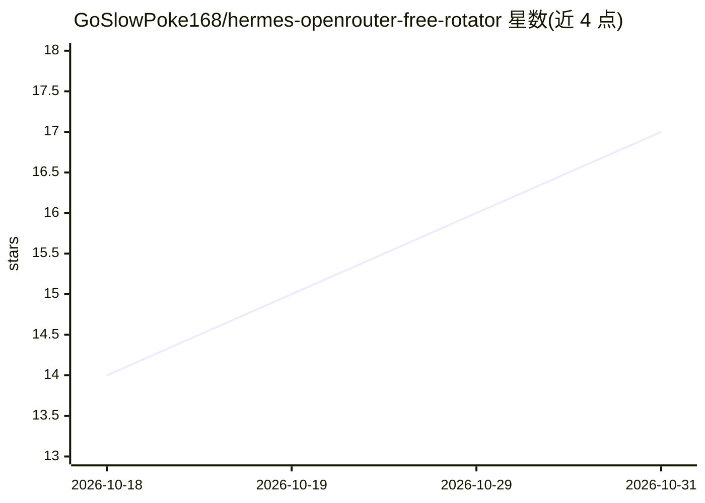

# GoSlowPoke168/hermes-openrouter-free-rotator

⭐ 17 · Python · MIT · 推送 2026-10-11 · [GitHub](https://github.com/GoSlowPoke168/hermes-openrouter-free-rotator) · 个人维护

**Hermes Agent 插件：自动轮换 OpenRouter 免费模型**

面向 Hermes Agent 用户的插件：每日对 OpenRouter 的 :free 模型集合按隐私层级（private/logs/trains/unknown）与使用量排序，筛选出支持工具调用、未过期且可用的模型，自动改写 Hermes 配置中的 model.default 与 fallback_providers；即将过期的模型会在到期前被替换。隐私层级需抓取各模型页面的数据政策并缓存 24 小时。提供 CLI 与会话内斜杠命令，支持固定（pin）某一模型和四种隐私选择模式。要求 Hermes >=0.21.0，Linux 已测试，Windows 为实验性。

## 筛选速览

| 维度 | 判定 | 备注 |
|---|---|---|
| AI 角色 | `ai-ecosystem` | LLM/agent 周边工具 |
| 许可风险 | `permissive` | MIT |
| 部署形态 | `None` |  |
| 模型依赖 | locked-api |  |
| 硬件要求 | — | 无带数字的原话,不猜 |
| 安装摩擦 | `low` | 无编译、无系统依赖或容器化 |
| 成熟度 | `idea` | |

## 能力要点

- 每日按隐私层级与使用量排序并自动轮换默认与 fallback 免费模型
- 四种选择模式（strict/balanced/relaxed/loose）控制隐私与排名的取舍
- pin/unpin 固定模型，过期前 48 小时预警并提前替换
- 通过 Hermes cron 每日调度，无需 agent 或 LLM 参与

## 适用场景

- 让 Hermes Agent 长期使用 OpenRouter 免费模型而无需手动更换
- 按隐私偏好自动挑选不训练用户数据的免费模型
- 在模型过期前自动切换，避免服务中断

## 场景标签

`模型网关` · 领域:Agent 开发

## 证据(README 行号)

> L3: A Hermes Agent plugin that keeps your
> L8: this plugin ranks the free-models collection,
> L176: Rotation changes `model.default` and managed OpenRouter `:free` fallbacks.

## 星数曲线

2026-10-18 14 → 2026-10-31 17（+3）

---
*卡片 v1 · prompt 1.4 · 生成 2026-10-30 · 置信度 high · 依据 README sha `09b12358f1c5` · [字段定义](../../DATASET.md)*
