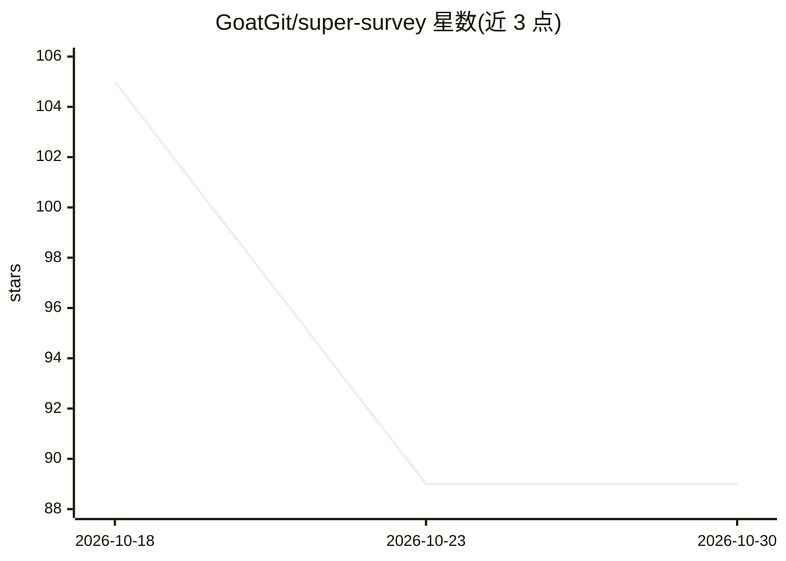

# GoatGit/super-survey

⭐ 89 · Python · MIT · 推送 2026-09-29 · [GitHub](https://github.com/GoatGit/super-survey) · [官网]( https://github.com/GoatGit/super-survey) · 个人维护 · 中文 README

**面向 agent 的多轮调研技能：把模糊问题转为循证研究报告**

一个可复用的 agent 研究技能（Skills CLI / Codex 技能目录形式安装），实现论文 Resisting AI Sycophancy in Open-Ended Research 的方法：在检索证据前先重构目标函数、约束与隐含假设，再经 research→brainstorm→redteam→synthesis→evolve 多轮阶段推进，由 evolver 决定是否进入下一轮或生成最终报告。每次调研持久化 markdown 工件与 JSONL 证据注册表（sources/evidence/claims），并提供 quick/standard/deep 三种模式与最低证据数量、报告分数门槛。CLI 仅依赖 Python 标准库（3.9+），Node.js 仅用于可选的 Skills CLI 安装。

## 筛选速览

| 维度 | 判定 | 备注 |
|---|---|---|
| AI 角色 | `ai-ecosystem` | LLM/agent 周边工具 |
| 许可风险 | `permissive` | MIT |
| 部署形态 | `library` | 以包/库形式分发 |
| 模型依赖 | — | README 未给出锁定关系 |
| 硬件要求 | — | 无带数字的原话,不猜 |
| 安装摩擦 | `low` | 无编译、无系统依赖或容器化 |
| 成熟度 | — | 结构信号不足 |

## 能力要点

- 多轮阶段工作流：research→brainstorm→redteam→synthesis→evolve，evolver 决策控制是否收敛
- JSONL 证据注册表（sources/evidence/claims）保证可审计性，check/check-final 校验一致性
- quick/standard/deep 三档模式，含最低来源/声明/证据数量与报告分数门槛
- 四种来源范围模式（local-only/local-first/current-first/open）与反谄媚框架检查

## 适用场景

- 让 agent 对产品机会或市场做有证据支撑的调研报告
- 开源项目选型或技术可行性研究
- 投资式尽调或战略探索（含对抗性红队批判）

## 场景标签

`科研工具` · 领域:学习与行业

## 证据(README 行号)

> L9: Super Survey is a general-purpose research skill for agents. It is not a domain-specific stock, product, or open-sou
> L11: The project is a concrete implementation of the paper Resisting AI Sycophancy in Open-Ended Research. The paper arg
> L67: Codex users can also copy this repository into the Codex skills directory:

## 星数曲线

2026-10-18 105 → 2026-10-30 89（-16）

---
*卡片 v1 · prompt 1.4 · 生成 2026-10-23 · 置信度 high · 依据 README sha `83539924f588` · [字段定义](../../DATASET.md)*
