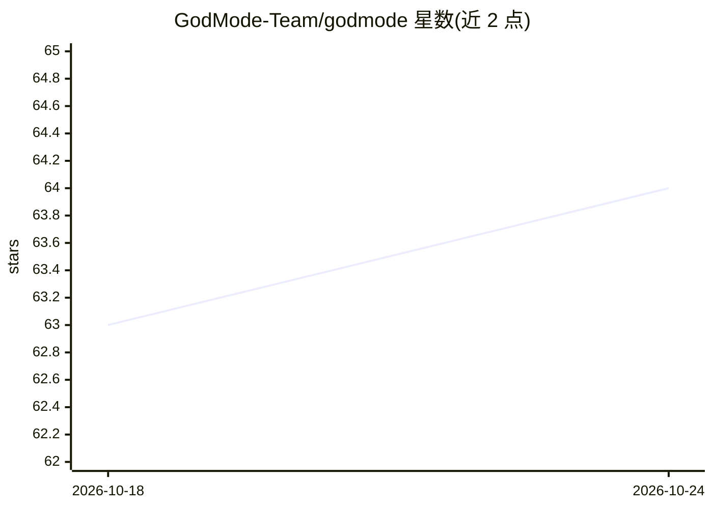

# GodMode-Team/godmode

⭐ 64 · TypeScript · NOASSERTION · 推送 2026-07-18 · [GitHub](https://github.com/GodMode-Team/godmode) · [官网](https://lifeongodmode.com) · 组织维护

**面向创业者的个人 AI 工作区：OpenClaw 一体化插件配置**

以 OpenClaw 插件形式提供的个人 AI 工作区设置：包含 5 层持久记忆（会话记忆、工作记忆、长期库、每日笔记、自愈规则）、35 个可由主 AI Ally 调度的专业 agent，通过 Composio 等接入邮件、日历、Slack、GitHub、CRM 等工具；以 Markdown 文件定制人设、技能卡与 SOUL.md。必需环境为 Node.js 22+、pnpm、OpenClaw >=2026.2.0 与 ANTHROPIC_API_KEY，持久会话记忆需 Honcho API key，缺少时跨会话不保留。提供一键脚本、插件安装与源码构建三种安装方式。许可为 FSL-1.1-MIT，禁止用于构建竞争性商业产品，两年后转 MIT。

## 筛选速览

| 维度 | 判定 | 备注 |
|---|---|---|
| AI 角色 | `ai-ecosystem` | LLM/agent 周边工具 |
| 许可风险 | `none` | NOASSERTION |
| 部署形态 | `library` | 以包/库形式分发 |
| 模型依赖 | — | README 未给出锁定关系 |
| 硬件要求 | — | 无带数字的原话,不猜 |
| 安装摩擦 | `low` | 无编译、无系统依赖或容器化 |
| 成熟度 | — | 结构信号不足 |

## 能力要点

- 5 层持久记忆结构（含长期库与自愈规则）
- 35 个专业 agent 编排，接入邮件/日历/Slack/GitHub/CRM 等工具
- 以 Markdown 文件定制人设、技能卡与 SOUL.md，无需写 TypeScript
- 一行脚本安装，覆盖 Node.js/OpenClaw/插件/网关配置

## 适用场景

- 创业者在一个对话中调度多个 agent 处理研究、写作、工程、分析任务
- 构建带持久记忆、跨会话记住决策与偏好的个人 AI 助手
- 把已有工具栈（邮件、日历、Slack、Notion）接入统一 AI 工作区

## 场景标签

`AI 助手` `多智能体` · 领域:Agent 开发

## 证据(README 行号)

> L3: ### Personal AI OS for Entrepreneurs — The Ultimate OpenClaw Setup
> L61: openclaw plugins install @godmode-team/godmode
> L125: ├── index.ts              # OpenClaw plugin entry point

## 星数曲线

2026-10-18 63 → 2026-10-24 64（+1）

---
*卡片 v1 · prompt 1.4 · 生成 2026-10-24 · 置信度 low · 依据 README sha `c58f1650be47` · [字段定义](../../DATASET.md)*
