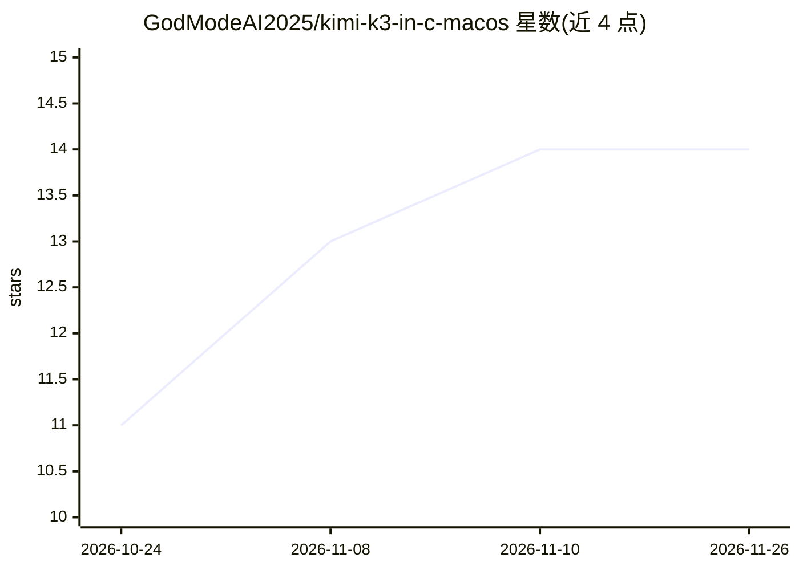

# GodModeAI2025/kimi-k3-in-c-macos

⭐ 14 · Python · Apache-2.0 · 推送 2026-09-22 · [GitHub](https://github.com/GodModeAI2025/kimi-k3-in-c-macos) · 个人维护

**把 kimi-k3-in-c 推理引擎移植到 macOS（Apple Silicon）的补丁与安装器**

对 FareedKhan-dev/kimi-k3-in-c 的 macOS 移植包：提供上下文校验的补丁脚本 apply_macos_port.py、从指定 upstream commit 克隆并构建的 install-macos.sh，以及离线校验套件 validate.sh。技术改动包括 arm64 NEON 内建函数替换 AVX2、F_NOCACHE 替代 O_DIRECT、Mach VM 内存探测、可选 OpenMP（Homebrew libomp）等。不含模型权重（checkpoint 约 1.56 TB），下载由用户自理。目标平台为 Apple Silicon，README 说明上游已于 2026 年 8 月合并部分 macOS 支持，本包与其存在部分重叠。

## 筛选速览

| 维度 | 判定 | 备注 |
|---|---|---|
| AI 角色 | `ai-native` | 本体是模型或模型工具 |
| 许可风险 | `permissive` | Apache-2.0 |
| 部署形态 | `desktop` | 安装包/桌面程序 |
| 模型依赖 | — | README 未给出锁定关系 |
| 硬件要求 | — | 无带数字的原话,不猜 |
| 安装摩擦 | `medium` | 含编译或系统依赖之一 |
| 成熟度 | — | 结构信号不足 |

## 能力要点

- 上下文校验补丁：任何源码偏差即中止，幂等可重复应用
- Apple Silicon 原生 NEON 路径用于 BF16/MXFP4 点积内核
- install-macos.sh 一键克隆指定 commit、移植、构建并测试
- 离线校验套件 validate.sh 检查变换幂等性与 NEON 路径

## 适用场景

- 在 Apple Silicon Mac 上从本地磁盘流式运行 Kimi K3 权重
- 将已有的 kimi-k3-in-c checkout 移植到 macOS 并本地构建
- 离线验证移植补丁与上游的差异

## 场景标签

`推理引擎` · 领域:训练与推理

## 证据(README 行号)

> L5: Dieses Paket portiert **FareedKhan-dev/kimi-k3-in-c** auf macOS: ein kontextgeprüfter
> L12: - `install-macos.sh`, der genau diesen Commit klont, portiert, baut und testet
> L13: - native NEON-Pfade für die BF16- und MXFP4-Dot-Products auf Apple Silicon

## 星数曲线

2026-10-24 11 → 2026-11-26 14（+3）

---
*卡片 v1 · prompt 1.4 · 生成 2026-11-18 · 置信度 high · 依据 README sha `379b57866cd5` · [字段定义](../../DATASET.md)*
