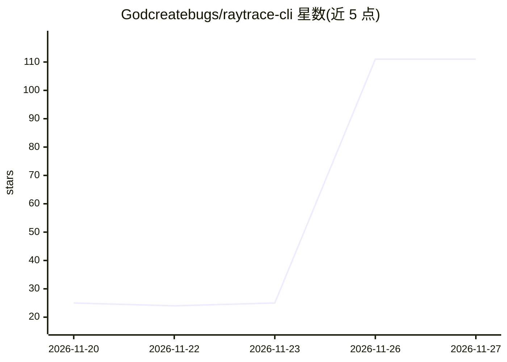

# Godcreatebugs/raytrace-cli

⭐ 111 · JavaScript · MIT · 推送 2026-11-26 · [GitHub](https://github.com/Godcreatebugs/raytrace-cli) · [官网](https://www.raytracer.si/) · 组织维护

**编码 Agent 本地沙箱：隔离运行并记录其真实行为**

为 Claude Code 或 Codex 提供本地隔离运行环境：每个沙箱是 Lima 创建的 Linux VM 内、gVisor 之下的 Docker 容器，Agent 在项目副本上工作，无法看到本机文件与私有网络。沙箱外的收集器记录每条命令、真实退出码、文件读写与网络连接，仪表盘将 Agent 报告的 Tool calls 与机器看到的 Sandbox evidence 分层对照。支持 fork 重放（Playground）、文件风险评级与受限文件、PR 评论报告。npm/PyPI 安装，本地沙箱 MIT 许可免费，云端沙箱可选。

## 筛选速览

| 维度 | 判定 | 备注 |
|---|---|---|
| AI 角色 | `ai-ecosystem` | LLM/agent 周边工具 |
| 许可风险 | `permissive` | MIT |
| 部署形态 | `library` | 以包/库形式分发 |
| 模型依赖 | — | README 未给出锁定关系 |
| 硬件要求 | — | 无带数字的原话,不猜 |
| 安装摩擦 | `low` | 无编译、无系统依赖或容器化 |
| 成熟度 | — | 结构信号不足 |

## 能力要点

- 沙箱外收集器记录命令、真实退出码、文件与网络访问，Agent 无法关闭或篡改
- Tool calls 与 Sandbox evidence 双层对照，差异可见
- Playground 从任一步骤 fork 重放，可改工具结果/文件/模型并对比结果
- Initial scan 按 1-5 评级文件风险，可限制 Agent 不得修改

## 适用场景

- 让编码 Agent 在隔离副本中运行，防止其触及本机密钥与私有网络
- 核验 Agent 声称的"测试通过"是否与真实退出码一致
- 对比不同模型或提示改动在同一会话步骤上的结果
- 在 PR 评论中附上命令、文件改动与成本的运行报告

## 场景标签

`网络安全` `LLM 可观测性` · 领域:评测与运维

## 证据(README 行号)

> L52: RayTrace runs Claude Code or Codex in that isolated copy, records what actually
> L55: Each local sandbox is a Docker container under gVisor,
> L62: The dashboard has two layers. **Tool calls** are what the agent reported.

## 星数曲线

2026-11-20 25 → 2026-11-27 111（+86）

---
*卡片 v1 · prompt 1.4 · 生成 2026-11-20 · 置信度 high · 依据 README sha `5b4a12e1abba` · [字段定义](../../DATASET.md)*
