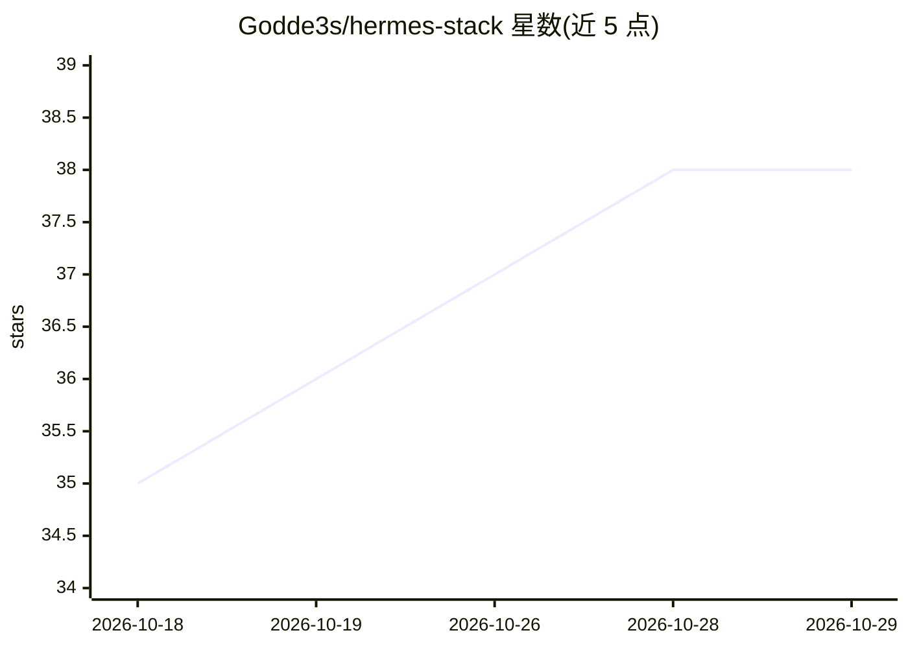

# Godde3s/hermes-stack

⭐ 38 · Python · MIT · 推送 2026-09-27 · [GitHub](https://github.com/Godde3s/hermes-stack) · 个人维护 · 中文 README

**一键把免费 HF Space 部署为个人 AI 服务器栈**

把 Hermes Agent、9Router 与 OmniRouter 打包部署到一个免费 Hugging Face Space（Docker），经 Caddy 统一反代，提供路由 Web 仪表盘、OpenAI 兼容 API、Agent 仪表盘与 Telegram 网关。机制上含每小时状态备份到私有 HF 数据集、keep-alive GitHub Action、崩溃自愈 supervisor，OmniRouter 提供约 78 个免 API key 的网页模型。支持 Web 向导、GitHub Actions 模板或 huggingface-cli 手动三种部署方式；限制：免费 Space 非全天候服务器（约 48h 睡眠限制），README 强调合规使用免费层。

## 筛选速览

| 维度 | 判定 | 备注 |
|---|---|---|
| AI 角色 | `ai-ecosystem` | LLM/agent 周边工具 |
| 许可风险 | `permissive` | MIT |
| 部署形态 | `None` |  |
| 模型依赖 | — | README 未给出锁定关系 |
| 硬件要求 | — | 无带数字的原话,不猜 |
| 安装摩擦 | `medium` | 含编译或系统依赖之一 |
| 成熟度 | — | 结构信号不足 |

## 能力要点

- 三种部署途径：客户端侧 Web 向导 / GitHub 模板 / huggingface-cli 手动
- 每小时备份到私有 HF 数据集，重启自动恢复
- OmniRouter 提供约 78 个零 API key 的免费模型
- OpenAI 兼容 API（路由 /v1 与 /hermes-api/v1 两处）

## 适用场景

- 不花钱在 HF 免费 Space 上跑一个带 Telegram 入口的个人 AI agent
- 给自己搭一个 OpenAI 兼容的多模型 API 端点
- 需要持久化状态的轻量自托管 agent 服务

## 场景标签

`模型网关` `AI 助手` · 领域:Agent 开发

## 证据(README 行号)

> L3: **Turn one free Hugging Face Space into a real personal AI server:**
> L21: |`https://<user>-<space>.hf.space/v1`|🔌 OpenAI-compatible API (use in any client)|

## 星数曲线

2026-10-18 35 → 2026-10-29 38（+3）

---
*卡片 v1 · prompt 1.4 · 生成 2026-10-25 · 置信度 high · 依据 README sha `037f235d74de` · [字段定义](../../DATASET.md)*
