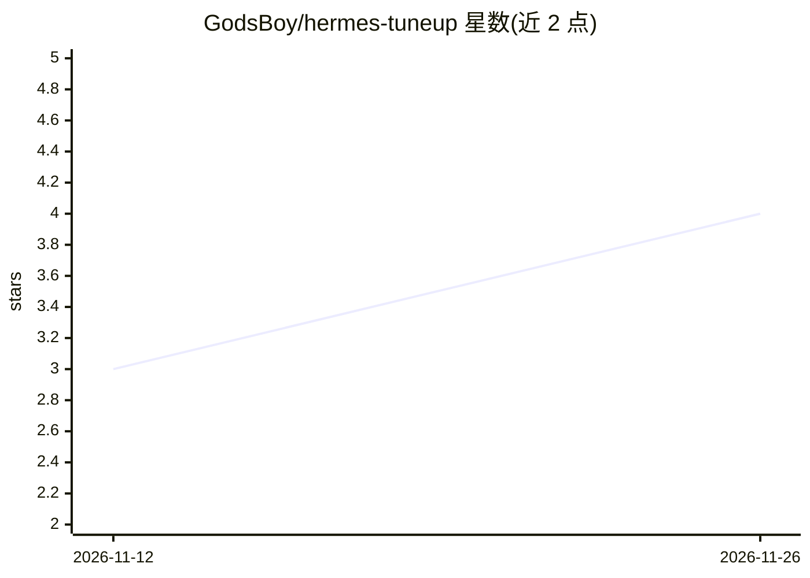

# GodsBoy/hermes-tuneup

⭐ 4 · Python · MIT · 推送 2026-11-10 · [GitHub](https://github.com/GodsBoy/hermes-tuneup) · 个人维护

**Hermes Agent 插件：检查各 profile 的压缩触发点与浪费配额的设置**

为 Hermes Agent 提供的配置诊断插件：向 Hermes 自身的代码询问每个 profile 各路由的真实上下文窗口与压缩触发阈值，以 token 数报告何时触发 compaction；检测永不匹配的 model_thresholds 规则、过小的 summariser、破坏 prompt cache 的 pruning、过高的子代理推理档位等五类问题。修复需用户确认，带 diff 预览与备份，读取过程在临时 Hermes home 中运行、不传 API key。提供 chat 命令、终端命令（含 CI 退出码）与 Desktop 只读面板三种使用方式。

## 筛选速览

| 维度 | 判定 | 备注 |
|---|---|---|
| AI 角色 | `ai-ecosystem` | LLM/agent 周边工具 |
| 许可风险 | `permissive` | MIT |
| 部署形态 | `None` |  |
| 模型依赖 | — | README 未给出锁定关系 |
| 硬件要求 | — | 无带数字的原话,不猜 |
| 安装摩擦 | `low` | 无编译、无系统依赖或容器化 |
| 成熟度 | — | 结构信号不足 |

## 能力要点

- 从 Hermes 自身压缩配置解析器读取真实触发数字，而非仅显示百分比
- 检测五类设置问题：规则永不匹配、summariser 过小、pruning 破坏缓存、子代理高推理档位、cap 限制触发
- 修复经确认后写入，带 diff 预览、备份与防过期检查
- 终端命令提供 0/1/2 退出码，可在 CI 中运行

## 适用场景

- 排查 Hermes Agent 配额被异常消耗的原因
- 检查 model_thresholds 规则是否真的作用于目标模型
- 避免在订阅路由上开启 pruning 导致 prompt cache 每轮失效
- 在 CI 中于 Hermes 更新后自动检查配置健康度

## 场景标签

`LLM 可观测性` `提示工程` · 领域:Agent 开发

## 证据(README 行号)

> L4:  A plugin for Hermes Agent that checks every profile against the model routes it actually runs.
> L44: tuneup asks Hermes' own code for the real numbers, so what it reports is what Hermes does.
> L87: `hermes tuneup check` exits 0 when everything is clean, 1 when there is a high-severity finding, and 2 when a profi

## 星数曲线

2026-11-12 3 → 2026-11-26 4（+1）

---
*卡片 v1 · prompt 1.4 · 生成 2026-11-22 · 置信度 high · 依据 README sha `664ea5f06fc7` · [字段定义](../../DATASET.md)*
