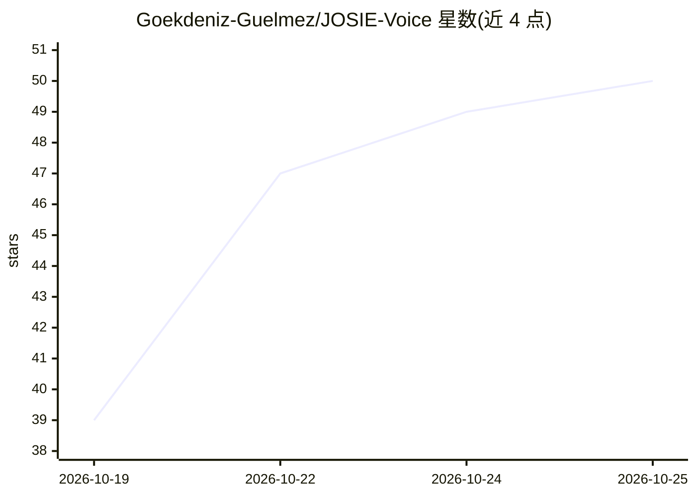

# Goekdeniz-Guelmez/JOSIE-Voice

⭐ 50 · 推送 2026-10-21 · [GitHub](https://github.com/Goekdeniz-Guelmez/JOSIE-Voice) · [官网](https://goekdeniz-guelmez.github.io/JOSIE-Voice/) · 个人维护

**Apple Silicon 上的本地语音助手：对话并操作 Mac 原生应用**

面向 Mac 用户的本地语音与聊天助手：语音活动检测、语音识别、说话人识别与语音合成全部在本机 Apple Silicon 上运行（Qwen3-ASR/Parakeet/WeSpeaker/Qwen3-TTS/Kokoro 82M），语言模型默认走 Ollama 端点。可通过语音操作 Reminders、Calendar、Maps、Messages，支持语音克隆、摄像头问答、文档附件、语义检索库与本地 OpenAI 兼容 API 服务器。限制：首个公开 DMG 计划 2026 年 12 月发布，当前无可下载安装包，截图均为 mockup。要求 macOS 14+ 与 M1 及以上。

## 筛选速览

| 维度 | 判定 | 备注 |
|---|---|---|
| AI 角色 | `ai-native` | 本体是模型或模型工具 |
| 许可风险 | `none` | — |
| 部署形态 | `None` |  |
| 模型依赖 | local-ok | 支持本地模型 |
| 硬件要求 | — | 无带数字的原话,不猜 |
| 安装摩擦 | `low` | 无编译、无系统依赖或容器化 |
| 成熟度 | `idea` | |

## 能力要点

- 听、识别、说话人识别与语音合成全部在本机运行，无需账号
- 通过语音操作 Reminders/Calendar/Maps/Messages（每项默认关闭）
- 语言模型默认接入 Ollama，语音/识别模型可在设置中切换
- 支持语音克隆、语音设计、多 Persona 与本地 OpenAI 兼容 API

## 适用场景

- 在 Mac 上与本地语音助手对话并让它代建提醒和日程
- 语音克隆与多说话人识别的个人助手体验
- 通过 iPhone 经 Tailscale 连接 Mac 上的助手（预览功能）

## 场景标签

`语音 Agent` · 领域:对话与助手

## 证据(README 行号)

> L7:  Hearing, voice recognition and speech all run on your Mac, so your voice never leaves it.
> L154: - **Listening:** Silero VAD notices when you speak, and Smart Turn v3 knows when you've finished.
> L157: - **Speech:** Qwen3-TTS by default, with voice cloning and voice design, or Kokoro 82M (chosen in Settings).

## 星数曲线

2026-10-19 39 → 2026-10-25 50（+11）

---
*卡片 v1 · prompt 1.4 · 生成 2026-10-25 · 置信度 high · 依据 README sha `18de69877606` · [字段定义](../../DATASET.md)*
