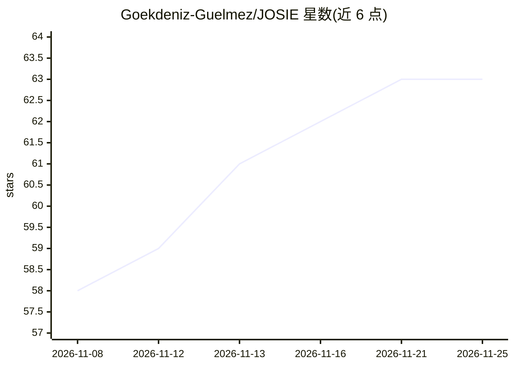

# Goekdeniz-Guelmez/JOSIE

⭐ 63 · 推送 2026-11-17 · [GitHub](https://github.com/Goekdeniz-Guelmez/JOSIE) · [官网](https://goekdeniz-guelmez.github.io/JOSIE/) · 个人维护

**macOS 本地全双工语音/聊天助手：可操作日历提醒等 Apple 应用**

面向 Mac 用户的本地语音与聊天助手：语音识别、说话人辨认（三条短语声纹注册）与语音合成均在设备端运行，支持打断式全双工对话，可调用八种本地全双工语音引擎（LFM3、Moshi、Haru 等）并可从 Hugging Face 添加自定义模型。可操作 Reminders、Calendar、Maps、Messages，语言模型可选 Ollama、Anthropic Claude、OpenAI 兼容服务或 Apple Intelligence。提供本地 API 服务器与 Library 文档嵌入检索。首个 DMG 安装包尚未发布（计划 2026 年 12 月），需 Apple Silicon（M1+）与 macOS 14+。

## 筛选速览

| 维度 | 判定 | 备注 |
|---|---|---|
| AI 角色 | `ai-native` | 本体是模型或模型工具 |
| 许可风险 | `none` | — |
| 部署形态 | `None` |  |
| 模型依赖 | local-ok | 支持本地模型 |
| 硬件要求 | — | 无带数字的原话,不猜 |
| 安装摩擦 | `low` | 无编译、无系统依赖或容器化 |
| 成熟度 | — | 结构信号不足 |

## 能力要点

- 听觉、声纹识别与语音合成全部在本机运行，无需账号
- 8 种本地全双工语音引擎，可添加 Hugging Face 自定义微调模型
- 14 种语音合成引擎、10 种语音识别引擎可选
- 可操作 Reminders/Calendar/Maps/Messages 并提供本地 /v1/realtime API

## 适用场景

- 在 Mac 上用语音对话并让助手写入提醒和日历
- 通过声纹辨认区分不同说话人
- 在 iPhone/iPad/Watch 上连接 Mac 作为语音服务端

## 场景标签

`语音 Agent` · 领域:对话与助手

## 证据(README 行号)

> L6:  A voice and chat assistant that listens, knows who's speaking, talks back with a natural voice, and takes real acti
> L7:  Hearing, voice recognition and speech all run on your Mac, so your voice never leaves it.
> L173: |**Private by design**|Hearing, voice recognition and speech run on your Mac. Your data stays on your Mac. No acco

## 星数曲线

2026-11-08 58 → 2026-11-25 63（+5）

---
*卡片 v1 · prompt 1.4 · 生成 2026-11-18 · 置信度 high · 依据 README sha `115c657bdf5d` · [字段定义](../../DATASET.md)*
