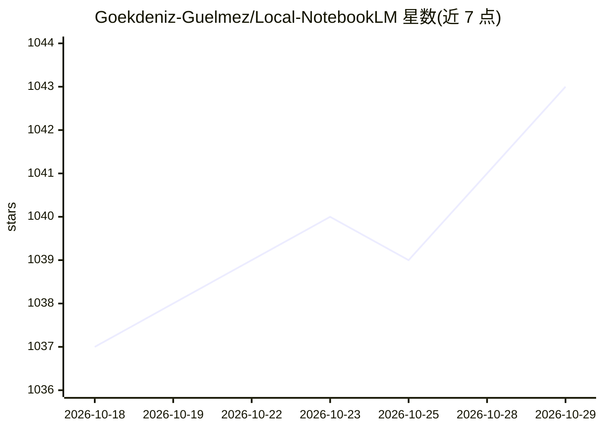

# Goekdeniz-Guelmez/Local-NotebookLM

⭐ 1,043 · Python · Apache-2.0 · 推送 2026-05-08 · [GitHub](https://github.com/Goekdeniz-Guelmez/Local-NotebookLM) · 个人维护

**把 PDF 转成播客等音频内容的本地 AI 工具**

读取 PDF 提取文本，经 LLM 生成播客、访谈、摘要等 16 种格式的脚本，再由 TTS 转为音频，支持 1-5 人对话与多种风格长度选项。支持 OpenAI、Groq、LMStudio、Ollama、Azure 等 LLM 提供商，可配合本地 LLM/TTS 服务器离线运行。提供 CLI、Python API、Gradio Web UI 与 FastAPI 服务四种使用方式，可通过 pip、源码或 Docker 安装，需 Python 3.9+、8GB 内存（本地模型建议 32GB+）。

## 筛选速览

| 维度 | 判定 | 备注 |
|---|---|---|
| AI 角色 | `ai-native` | 本体是模型或模型工具 |
| 许可风险 | `permissive` | Apache-2.0 |
| 部署形态 | `self-host` | docker 或自建部署 |
| 模型依赖 | local-ok | 支持本地模型 |
| 硬件要求 | — | 无带数字的原话,不猜 |
| 安装摩擦 | `low` | 无编译、无系统依赖或容器化 |
| 成熟度 | — | 结构信号不足 |

## 能力要点

- 16 种输出格式（播客/访谈/辩论/讲座等），支持 1-5 说话人
- 多 LLM 提供商接入（OpenAI/Groq/LMStudio/Ollama/Azure），可本地推理
- CLI、Python API、Gradio Web UI、FastAPI 服务四种使用方式
- 多语言输出与 VLM 视觉模式（PDF 图片也送入 LLM）

## 适用场景

- 把论文或报告转成播客音频收听
- 生成摘要、访谈、辩论等多种风格的音频内容
- 接入自有项目通过 API 批量生成音频

## 场景标签

`语音合成` `AI 写作` · 领域:内容生成

## 证据(README 行号)

> L7: A local AI-powered tool that converts PDF documents into engaging audio—such as podcasts or custom audio content—usi
> L13: - Support for various LLM providers (OpenAI, Groq, LMStudio, Ollama, Azure)

## 星数曲线

2026-10-18 1,037 → 2026-10-29 1,043（+6）

---
*卡片 v1 · prompt 1.4 · 生成 2026-10-21 · 置信度 high · 依据 README sha `f0188ae5dd3f` · [字段定义](../../DATASET.md)*
