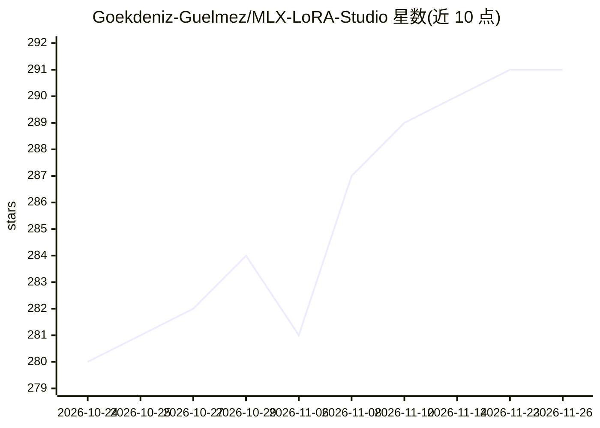

# Goekdeniz-Guelmez/MLX-LoRA-Studio

⭐ 291 · Swift · MIT · 推送 2026-10-27 · [GitHub](https://github.com/Goekdeniz-Guelmez/MLX-LoRA-Studio) · [官网](https://goekdeniz-guelmez.github.io/MLX-LoRA-Studio/) · 个人维护

**Apple Silicon 上的本地 Mac 应用：图形化 LLM 微调训练**

基于 SwiftUI/AppKit 的原生 macOS 应用，为 MLX 兼容语言模型提供全本地微调工作流：内置 12 种训练算法（SFT/DPO/GRPO/PPO 等）、LoRA/DoRA/QLoRA/全量微调与 QAT 训练模式，实时展示损失、内存等指标，支持断点续训、运行归档和一键上传 Hugging Face。应用自动发现或配置 Python 环境并内置 mlx-lm-lora 训练器。仅支持 macOS 14+ 且限 Apple Silicon 芯片，不含推理/聊天功能。

## 筛选速览

| 维度 | 判定 | 备注 |
|---|---|---|
| AI 角色 | `ai-native` | 本体是模型或模型工具 |
| 许可风险 | `permissive` | MIT |
| 部署形态 | `desktop` | 安装包/桌面程序 |
| 模型依赖 | — | README 未给出锁定关系 |
| 硬件要求 | — | 无带数字的原话,不猜 |
| 安装摩擦 | `low` | 无编译、无系统依赖或容器化 |
| 成熟度 | — | 结构信号不足 |

## 能力要点

- 12 种训练算法与 LoRA/DoRA/QLoRA/全参/QAT 模式
- 实时指标面板与内存监控，ResourceGuard 拒绝无法容纳的任务
- 运行归档、适配器续训与一键 Hugging Face 上传
- 自动发现或配置 Python 环境，自带 Python 与训练器

## 适用场景

- 在 Mac 本地微调开源 LLM 并产出适配器
- 对偏好数据做 DPO/GRPO 等偏好与强化学习训练
- 将训练完成的 LoRA 适配器发布到 Hugging Face

## 场景标签

`微调` `强化学习` · 领域:训练与推理

## 证据(README 行号)

> L3:  A native Mac App for LLM fine-tuning on Apple Silicon — fully on-device, fully open source.
> L28: - **Fully local fine-tuning workflow** for MLX-compatible language models.

## 星数曲线

2026-10-24 280 → 2026-11-26 291（+11）

---
*卡片 v1 · prompt 1.4 · 生成 2026-11-25 · 置信度 high · 依据 README sha `aedc6345edfc` · [字段定义](../../DATASET.md)*
