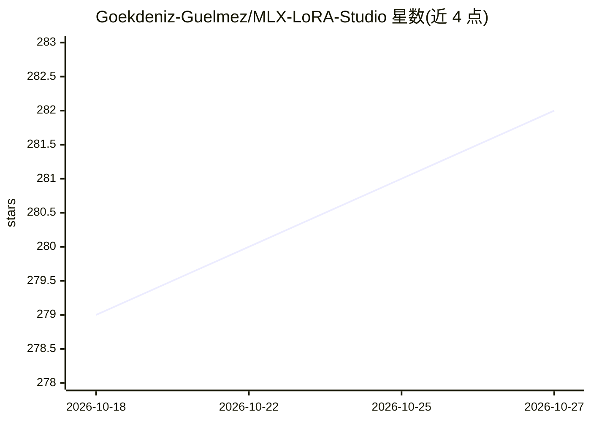

# Goekdeniz-Guelmez/MLX-LoRA-Studio

⭐ 282 · Swift · MIT · 推送 2026-10-13 · [GitHub](https://github.com/Goekdeniz-Guelmez/MLX-LoRA-Studio) · [官网](https://mlx-lora-studio.netlify.app) · 个人维护

**Apple Silicon 本地 LLM 微调 Mac 应用**

面向 Mac 用户（M 系列 Apple Silicon）的原生 macOS 应用，用 SwiftUI + AppKit 构建，作为 mlx-lm-lora Python 训练管线的图形前端，在设备上完成 LLM 微调。提供 12 种训练算法（SFT/DPO/GRPO/PPO 等）、LoRA/DoRA/QLoRA/全量微调与 QAT、实时指标与内存监控、ResourceGuard 启动前内存检查、运行归档与一键 Hugging Face 上传。限制：仅支持 macOS 14+ 与 Apple Silicon，16GB 内存起步，非推理服务器。安装方式为 DMG 拖装，需以 xattr 命令清除隔离标志。

## 筛选速览

| 维度 | 判定 | 备注 |
|---|---|---|
| AI 角色 | `ai-ecosystem` | LLM/agent 周边工具 |
| 许可风险 | `permissive` | MIT |
| 部署形态 | `desktop` | 安装包/桌面程序 |
| 模型依赖 | — | README 未给出锁定关系 |
| 硬件要求 | — | 无带数字的原话,不猜 |
| 安装摩擦 | `low` | 无编译、无系统依赖或容器化 |
| 成熟度 | `idea` | |

## 能力要点

- 12 种训练算法：SFT、DPO、DSLA、FTPO、CPO、ORPO、GRPO、KLPO、Online DPO、XPO、RLHF Reinforce、PPO
- LoRA/DoRA/QLoRA(4/6/8-bit)/全量微调/QAT 多种训练模式
- 实时指标面板与内存监控，ResourceGuard 在启动前拒绝系统装不下的任务
- 一键上传适配器到 Hugging Face，含模型卡与许可选择

## 适用场景

- 在 Mac 上不写代码完成 LoRA 微调并发布到 Hugging Face
- 研究人员通过 YAML 配置精调超参数并复跑实验
- 偏好学习/RLHF 类算法（DPO、GRPO、PPO）的本地实验

## 场景标签

`微调` `强化学习` · 领域:训练与推理

## 证据(README 行号)

> L42: - **Native macOS app for Apple Silicon** built with SwiftUI and AppKit.
> L91: - A **graphical front-end** to the `mlx-lm-lora`

## 星数曲线

2026-10-18 279 → 2026-10-27 282（+3）

---
*卡片 v1 · prompt 1.4 · 生成 2026-10-22 · 置信度 high · 依据 README sha `d4941fbbc7d4` · [字段定义](../../DATASET.md)*
