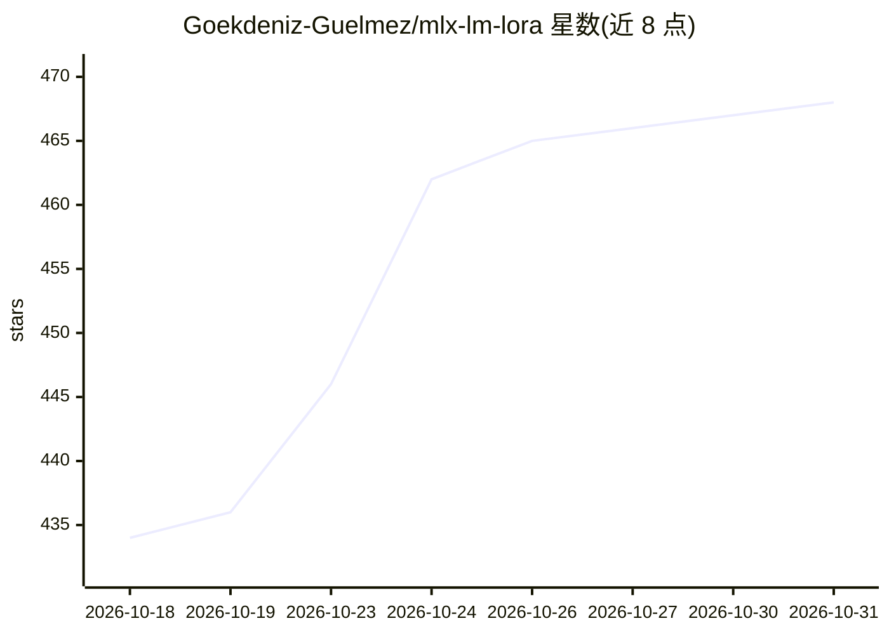

# Goekdeniz-Guelmez/mlx-lm-lora

⭐ 468 · Python · Apache-2.0 · 推送 2026-10-26 · [GitHub](https://github.com/Goekdeniz-Guelmez/mlx-lm-lora) · [官网](https://goekdeniz-guelmez.github.io/mlx-lm-lora/) · 个人维护

**在 Apple Silicon 上用 MLX 本地微调大语言模型的训练库**

基于 MLX 框架的 LLM 训练工具，面向在 Mac 上本地训练模型的开发者。主命令为 mlx_lm_lora.train，支持 LoRA/DoRA/全参数/量化（QLoRA 4/8-bit）训练与量化感知训练（QAT），训练算法覆盖 SFT、DPO、CPO、ORPO、GRPO、PPO 等十余种，兼容 MLX-LM 支持的全部模型（Llama、Mistral、Qwen、Gemma、OLMo 等）。通过命令行参数或 YAML 配置训练，数据采用 JSONL 格式，示例笔记本放在独立仓库。Apache 2.0 许可。

## 筛选速览

| 维度 | 判定 | 备注 |
|---|---|---|
| AI 角色 | `ai-ecosystem` | LLM/agent 周边工具 |
| 许可风险 | `permissive` | Apache-2.0 |
| 部署形态 | `library` | 以包/库形式分发 |
| 模型依赖 | — | README 未给出锁定关系 |
| 硬件要求 | — | 无带数字的原话,不猜 |
| 安装摩擦 | `medium` | 含编译或系统依赖之一 |
| 成熟度 | — | 结构信号不足 |

## 能力要点

- 支持 LoRA/DoRA/全参数/QLoRA 量化与 QAT 多种训练方式
- 覆盖 SFT、DPO、ORPO、GRPO、PPO 等十余种训练算法
- 兼容 MLX-LM 支持的全部模型（Llama/Mistral/Qwen/Gemma 等）
- 提供 CLI 与 YAML 配置两种训练入口

## 适用场景

- 在 Mac 上对开源 LLM 做 LoRA/DPO 偏好优化微调
- 用 GRPO 等强化学习算法与自定义奖励函数训练模型
- 通过 QAT 模拟量化效果以训练量化后的模型

## 场景标签

`微调` `强化学习` · 领域:训练与推理

## 证据(README 行号)

> L10: With MLX-LM-LoRA you can, train Large Language Models locally on Apple Silicon using MLX. Training works with all m

## 星数曲线

2026-10-18 434 → 2026-10-31 468（+34）

---
*卡片 v1 · prompt 1.4 · 生成 2026-10-21 · 置信度 high · 依据 README sha `54fad032c9f4` · [字段定义](../../DATASET.md)*
