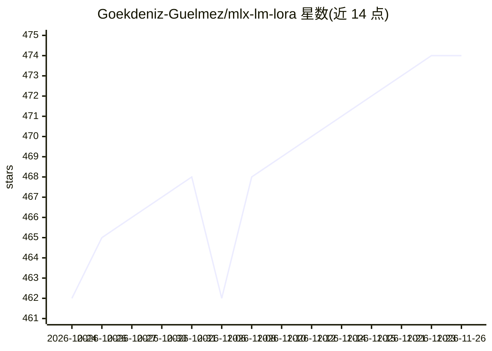

# Goekdeniz-Guelmez/mlx-lm-lora

⭐ 474 · Python · Apache-2.0 · 推送 2026-11-16 · [GitHub](https://github.com/Goekdeniz-Guelmez/mlx-lm-lora) · [官网](https://goekdeniz-guelmez.github.io/mlx-lm-lora/) · 个人维护

**在 Apple Silicon 上本地微调大语言模型的训练工具**

基于 MLX 框架的命令行训练工具，支持在 Apple Silicon 上对 MLX-LM 兼容模型（Llama、Mistral、Qwen、Gemma 等）进行本地微调。训练方式涵盖 LoRA、DoRA、全参数与量化感知训练（QAT），算法覆盖 SFT、DPO、ORPO、GRPO、PPO 等 16 种偏好优化方法；示例 notebook 与 YAML 配置存放于独立仓库。通过 pip 安装，主命令为 mlx_lm_lora.train，支持 YAML 配置文件与命令行参数覆盖。

## 筛选速览

| 维度 | 判定 | 备注 |
|---|---|---|
| AI 角色 | `ai-ecosystem` | LLM/agent 周边工具 |
| 许可风险 | `permissive` | Apache-2.0 |
| 部署形态 | `library` | 以包/库形式分发 |
| 模型依赖 | — | README 未给出锁定关系 |
| 硬件要求 | — | 无带数字的原话,不猜 |
| 安装摩擦 | `medium` | 含编译或系统依赖之一 |
| 成熟度 | — | 结构信号不足 |

## 能力要点

- 支持 LoRA/DoRA/全参数/4-8位量化训练与 QAT
- 覆盖 SFT、DPO、ORPO、GRPO、PPO 等 16 种训练算法
- QAT 在前向传播中应用 fake quantization，支持 2-16 bit
- 自定义奖励函数接入 GRPO 训练

## 适用场景

- 在 Mac 本地用 LoRA 微调开源大模型
- 用偏好数据对模型做 DPO/ORPO 对齐训练
- 用 GRPO/RLHF 方法做强化学习训练

## 场景标签

`微调` `强化学习` · 领域:训练与推理

## 证据(README 行号)

> L10: With MLX-LM-LoRA you can, train Large Language Models locally on Apple Silicon using MLX. Training works with all m
> L87: pip install -U mlx-lm-lora
> L22: **Training Types:**

## 星数曲线

2026-10-24 462 → 2026-11-26 474（+12）

---
*卡片 v1 · prompt 1.4 · 生成 2026-11-25 · 置信度 high · 依据 README sha `a6f87c1281f3` · [字段定义](../../DATASET.md)*
