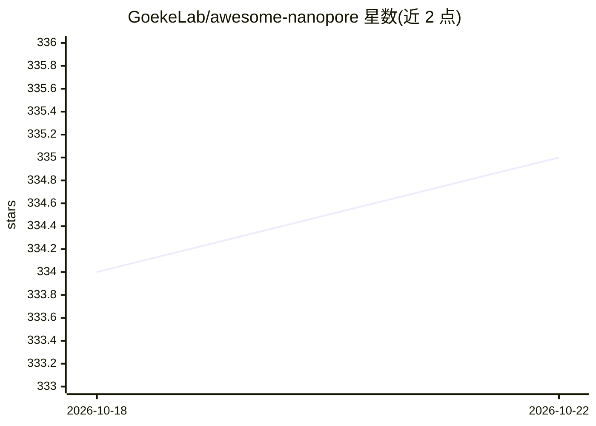

# GoekeLab/awesome-nanopore

⭐ 335 · MIT · 推送 2026-05-20 · [GitHub](https://github.com/GoekeLab/awesome-nanopore) · 组织维护

**纳米孔测序数据分析软件包策展清单（basecall 到转录组学）**

由 GoekeLab 维护的 nanopore 测序数据分析工具 awesome 清单：按类别组织第三方软件与流程，覆盖碱基识别（Dorado/Bonito 及 2016-2021 研究型 basecaller）、QC 与预处理、比对、信号分析、变异/SV/单倍型、DNA 与 RNA 修饰检测（区分 RNA004/RNA002 化学）、组装与抛光、转录组学、单细胞、模拟及 Nextflow 流程，另设已弃用/被取代条目章节。条目标注语言与一句话说明，接受社区贡献，不提供安装或运行内容。

## 筛选速览

| 维度 | 判定 | 备注 |
|---|---|---|
| AI 角色 | `ai-knowledge` | 知识聚合/清单类 |
| 许可风险 | `permissive` | MIT |
| 部署形态 | `None` |  |
| 模型依赖 | — | README 未给出锁定关系 |
| 硬件要求 | — | 无带数字的原话,不猜 |
| 安装摩擦 | `medium` | 含编译或系统依赖之一 |
| 成熟度 | — | 结构信号不足 |

## 能力要点

- 按碱基识别、信号分析、修饰检测、组装等十余个类别组织条目
- RNA 修饰工具按 RNA004/RNA002 化学体系分组
- 单独列出已被 ONT 弃用或被取代的工具章节
- 收录 Nextflow 流程（MOP2、nf-core/nanoseq 等）

## 适用场景

- 为 nanopore 测序项目按分析环节查找可用工具
- 了解 DNA/RNA 修饰检测工具对化学试剂版本的兼容性
- 确认某工具是否已被官方弃用或替代

## 场景标签

`精选清单` · 领域:学习与行业

## 证据(README 行号)

> L5: List of software packages for Nanopore sequencing data analysis, including basecalling, DNA/RNA modifications, etc. 
> L7: ## Table of contents

## 星数曲线

2026-10-18 334 → 2026-10-22 335（+1）

---
*卡片 v1 · prompt 1.4 · 生成 2026-10-21 · 置信度 high · 依据 README sha `24f5b1c29f6a` · [字段定义](../../DATASET.md)*
