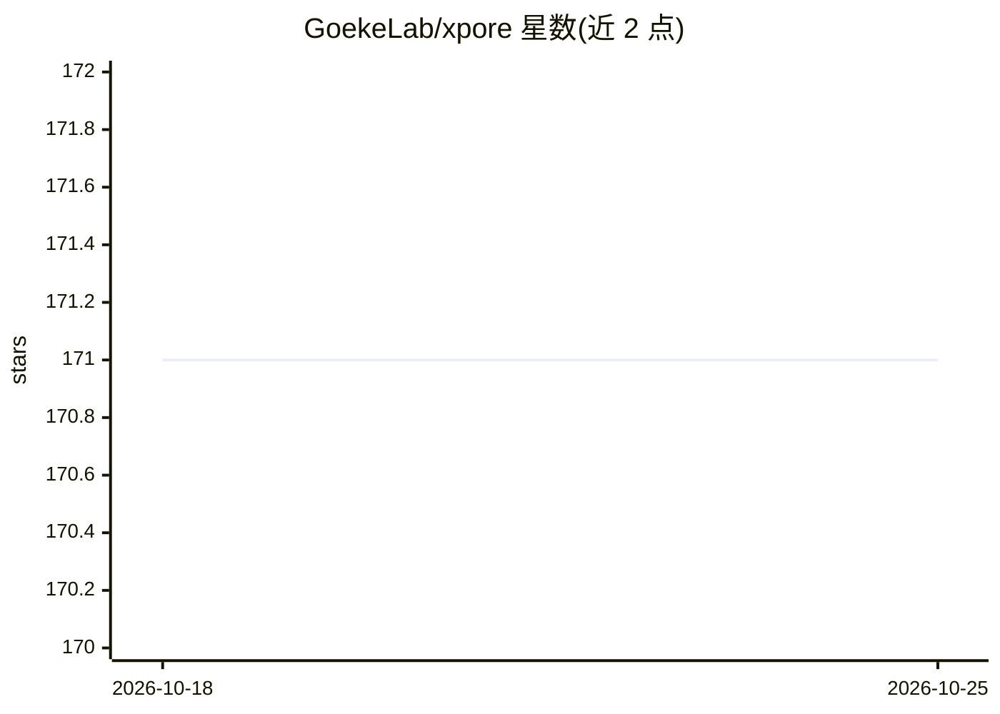

# GoekeLab/xpore

⭐ 171 · Python · MIT · 推送 2026-08-25 · [GitHub](https://github.com/GoekeLab/xpore) · [官网](https://xpore.readthedocs.io/) · 组织维护

**从纳米孔直接 RNA 测序数据识别差异 RNA 修饰的 Python 包**

xPore 是一个 Python 包，对纳米孔直接 RNA 测序（direct RNA sequencing）数据进行 RNA 修饰的识别与定量，并检测不同条件间的差异修饰。输入为 eventalign 文件（可用 f5c v1.7 及以上生成基因组比对版本）。当前版本 v2.2 支持 genome-aligned eventalign 输出（--kmer_source model_kmer 标志）与 RNA004 数据。面向生物信息学研究者，方法发表于 Nat Biotechnol (2021)，提供 readthedocs 文档。

## 筛选速览

| 维度 | 判定 | 备注 |
|---|---|---|
| AI 角色 | `ai-native` | 本体是模型或模型工具 |
| 许可风险 | `permissive` | MIT |
| 部署形态 | `library` | 以包/库形式分发 |
| 模型依赖 | — | README 未给出锁定关系 |
| 硬件要求 | — | 无带数字的原话,不猜 |
| 安装摩擦 | `low` | 无编译、无系统依赖或容器化 |
| 成熟度 | — | 结构信号不足 |

## 能力要点

- 纳米孔直接 RNA 测序数据的修饰识别与定量
- 差异修饰检测（xpore-diffmod）
- v2.2 支持 genome-aligned eventalign 输出与 RNA004 数据

## 适用场景

- 对纳米孔直接 RNA 测序数据做修饰位点识别与定量
- 比较不同样本间的差异 RNA 修饰
- 处理 RNA004 化学试剂盒数据

## 场景标签

 · 领域:基因组学/生物信息学

## 证据(README 行号)

> L7: xPore is a Python package for identification and quantification of differential RNA modifications from direct RNA se
> L22: xPore is described in details in Pratanwanich et al. *Nat Biotechnol* (2021)
> L26: The current release is xPore v2.2, which adds support for genome-aligned eventalign output (via the new `--kmer_sou

## 星数曲线

2026-10-18 171 → 2026-10-25 171（+0）

---
*卡片 v1 · prompt 1.4 · 生成 2026-10-22 · 置信度 high · 依据 README sha `b3e8ed3a7d56` · [字段定义](../../DATASET.md)*
