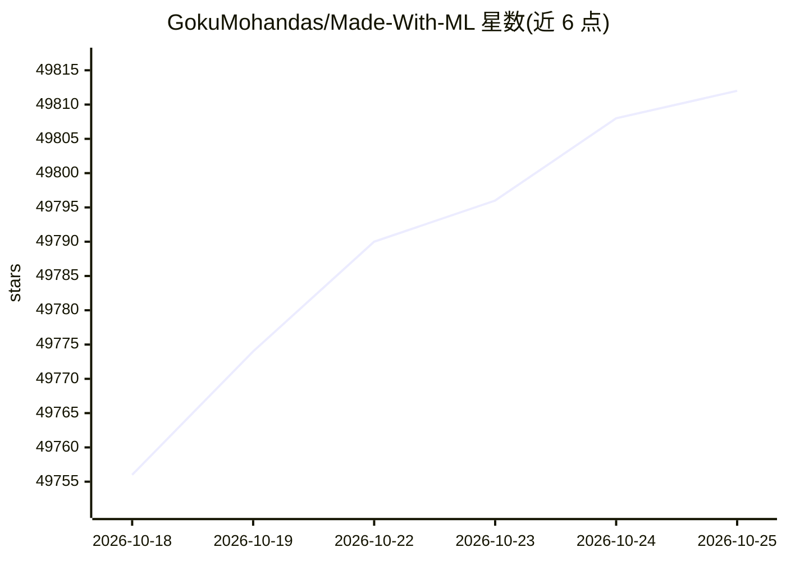

# GokuMohandas/Made-With-ML

⭐ 49,822 · Jupyter Notebook · MIT · 推送 2026-03-04 · [GitHub](https://github.com/GokuMohandas/Made-With-ML) · [官网](https://madewithml.com) · 个人维护

**面向开发者的生产级 ML/MLOps 应用开发课程**

一个以课程形式组织的仓库，配套站点 madewithml.com 提供课程内容，代码覆盖从实验（设计+开发）到生产（部署+迭代）的完整流程：Jupyter notebook 交互式讲解后重构为带测试、文档、日志的 Python 脚本，使用 MLflow 做实验跟踪，通过 Ray 本地或 Anyscale 集群运行训练、调参、评估、推理与服务，并演示 CI/CD 工作流。读者为各方向开发者、应届毕业生与想建立技术基础的产品/管理层。可在个人笔记本运行，也可按 Anyscale 配置使用 GPU 集群。

## 筛选速览

| 维度 | 判定 | 备注 |
|---|---|---|
| AI 角色 | `ai-knowledge` | 知识聚合/清单类 |
| 许可风险 | `permissive` | MIT |
| 部署形态 | `None` |  |
| 模型依赖 | — | README 未给出锁定关系 |
| 硬件要求 | — | 无带数字的原话,不猜 |
| 安装摩擦 | `low` | 无编译、无系统依赖或容器化 |
| 成熟度 | — | 结构信号不足 |

## 动量与使用信号

- 维护:`declining` — 距上次 push 227.3 天,年发版 1,1 位贡献者
- 涨星:近 1 天 **+8**(自 20261016 起算)
- 安装:github 包 `release-assets` 月下载无数据

## 能力要点

- 从 notebook 交互式学习到软件工程化脚本（测试、日志、版本化）的完整工作流
- 支持本地笔记本与 Anyscale 集群两种运行环境，并可部署到 AWS/GCP/K8s
- 使用 MLflow 做实验跟踪与模型注册
- 通过 Ray 提供模型服务，可用 cURL/Python 调用

## 适用场景

- 系统学习把 ML 模型从实验推进到生产部署的流程
- 在本地或云集群上实践分布式训练与模型服务
- 搭建 MLOps 各组件（跟踪、测试、服务、编排）的端到端练习项目

## 场景标签

`教程课程` `MLOps` · 领域:学习与行业

## 证据(README 行号)

> L16: Learn how to combine machine learning with software engineering to design, develop, deploy and iterate on productio
> L27: In this course, we'll go from experimentation (design + development) to production (deployment + iteration). We'll 
> L38: - **⚙️ MLOps**: connect MLOps components (tracking, testing, serving, orchestration, etc.) as we build an end-to-en

## 星数曲线

2026-10-18 49,756 → 2026-10-25 49,812（+56）

---
*卡片 v1 · prompt 1.4 · 生成 2026-10-18 · 置信度 high · 依据 README sha `b8623f265e1d` · [字段定义](../../DATASET.md)*
