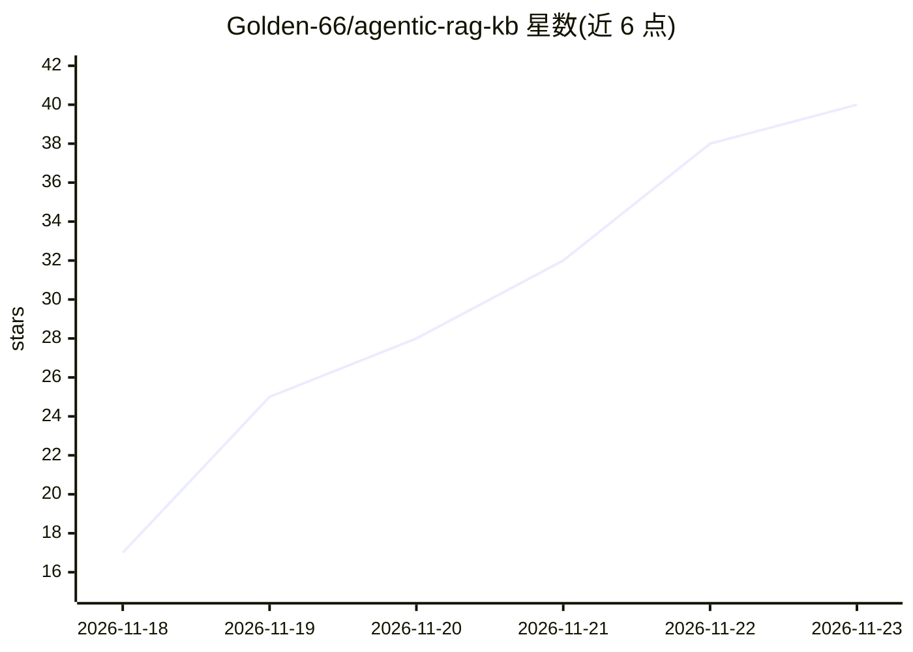

# Golden-66/agentic-rag-kb

⭐ 40 · Python · MIT · 推送 2026-11-16 · [GitHub](https://github.com/Golden-66/agentic-rag-kb) · 个人维护 · 中文 README

**企业级 Agentic RAG 知识库：混合检索+重排+Agent 流式问答**

基于 Agentic RAG 的智能知识库系统：PDF/MD/TXT 经 MinerU（或 pymupdf4llm 回退）解析，按标题层级做父子分块，检索采用 Dense + Sparse + BM25 多路召回与 RRF 融合，BGE-Reranker 重排；LangGraph Agent 负责意图路由、子问题拆解、HyDE 与迭代纠错，经 FastAPI 提供 SSE 流式问答接口，Streamlit 作为前端。支持 namespace 知识隔离、API Key 鉴权、Redis 多级缓存与降级，附带 Hit@K/MRR/Recall@K 评测脚本。首次启动需下载数 GB 模型，纯 CPU 可运行但较慢。

## 筛选速览

| 维度 | 判定 | 备注 |
|---|---|---|
| AI 角色 | `ai-native` | 本体是模型或模型工具 |
| 许可风险 | `permissive` | MIT |
| 部署形态 | `self-host` | docker 或自建部署 |
| 模型依赖 | — | README 未给出锁定关系 |
| 硬件要求 | — | 无带数字的原话,不猜 |
| 安装摩擦 | `low` | 无编译、无系统依赖或容器化 |
| 成熟度 | — | 结构信号不足 |

## 能力要点

- Dense+Sparse+BM25 混合检索与 BGE-Reranker 重排
- LangGraph Agent：意图路由/子问题拆解/HyDE/迭代纠错
- SSE 流式回答输出步骤状态、增量文本与引用来源
- 检索评测脚本输出 Hit@K、MRR、Recall@K

## 适用场景

- 给企业内部文档（如报销制度）搭一个带引用来源的问答系统
- 上传 PDF/Word 类文档自动入库并检索问答
- 按 namespace 隔离不同团队/项目的知识库
- 用自己的文档跑检索评测对比调参效果

## 场景标签

`RAG` `文档问答` · 领域:知识与检索

## 证据(README 行号)

> L3: 基于 **Agentic RAG** 的企业级智能知识库：文档解析 → 标题层级父子分块 → Dense + Sparse + BM25 混合检索 → Reranker 重排 → LangGraph 路由 Agent（意图识别 / 
> L27: |LangGraph Agent (路由/拆解/HyDE/纠错)|`backend/app/agent/graph.py`|
> L43: 首次启动后端会下载 BGE-M3 与 BGE-Reranker 模型（数 GB），请耐心等待；国内网络可在 `.env` 中加 `HF_ENDPOINT=https://hf-mirror.com`。纯 CPU 可运行但较慢，有 

## 星数曲线

2026-11-18 17 → 2026-11-23 40（+23）

---
*卡片 v1 · prompt 1.4 · 生成 2026-11-18 · 置信度 high · 依据 README sha `173064dc5be4` · [字段定义](../../DATASET.md)*
