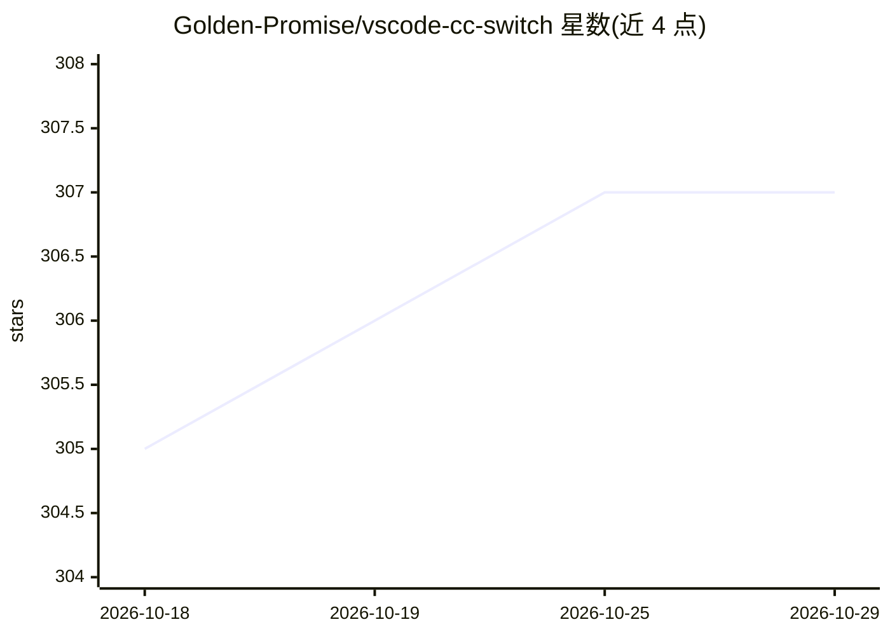

# Golden-Promise/vscode-cc-switch

⭐ 307 · MIT · 推送 2026-03-19 · [GitHub](https://github.com/Golden-Promise/vscode-cc-switch) · 个人维护 · 中文 README

**图文教程：用 VS Code + cc-Switch 让 Claude Code 调第三方模型 API**

面向开发者的保姆级图文教程仓库，逐步讲解如何安装 VS Code、cc-Switch 与 Claude Code 扩展，并配置第三方大模型 API（以硅基流动为例）。核心机制说明：cc-Switch 动态覆盖 ANTHROPIC_BASE_URL 与 ANTHROPIC_API_KEY 环境变量，将请求重定向至第三方接口，支持预存多套方案一键切换。教程覆盖本地环境与 Remote - SSH 远程环境（含本地代理与端口转发）两种配置路径。

## 筛选速览

| 维度 | 判定 | 备注 |
|---|---|---|
| AI 角色 | `ai-knowledge` | 知识聚合/清单类 |
| 许可风险 | `permissive` | MIT |
| 部署形态 | `desktop` | 安装包/桌面程序 |
| 模型依赖 | — | README 未给出锁定关系 |
| 硬件要求 | — | 无带数字的原话,不猜 |
| 安装摩擦 | `low` | 无编译、无系统依赖或容器化 |
| 成熟度 | — | 结构信号不足 |

## 能力要点

- 分步图文讲解 VS Code、cc-Switch、Claude Code 扩展的安装
- 说明 cc-Switch 覆盖 ANTHROPIC_BASE_URL/API_KEY 实现请求重定向的机制
- 覆盖本地与 Remote - SSH 远程（代理+RemoteForward 端口转发）两种环境
- 以硅基流动为例演示 API Key、Base URL、模型名称的配置

## 适用场景

- 我想让 Claude Code 用第三方 API 而不是官方渠道
- 我在远程服务器上通过 SSH 使用 Claude Code，需要配置第三方模型
- 我需要在多套 API 方案之间快速切换

## 场景标签

`教程课程` · 领域:学习与行业

## 证据(README 行号)

> L1: # 🚀 VS Code + cc-Switch 使用教程
> L3: 本教程旨在帮助开发者通过 **VS Code** 结合 **cc-Switch** 工具，快速实现 Claude Code 对第三方模型（API）的无缝调用与灵活配置。
> L61: 在开始配置前，需要从第三方平台获取以下信息（本文以**硅基流动 (SiliconFlow)** 为例，其他支持的模型或中转平台配置逻辑完全一致）：

## 星数曲线

2026-10-18 305 → 2026-10-29 307（+2）

---
*卡片 v1 · prompt 1.4 · 生成 2026-10-22 · 置信度 high · 依据 README sha `21148ec4c076` · [字段定义](../../DATASET.md)*
