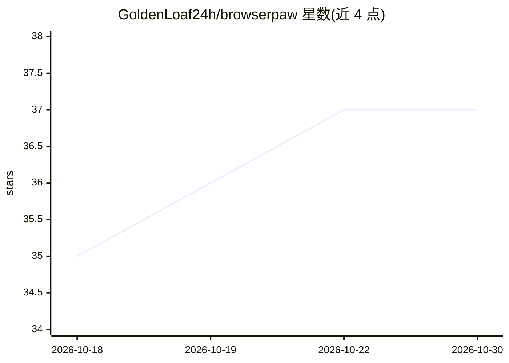

# GoldenLoaf24h/browserpaw

⭐ 37 · TypeScript · AGPL-3.0 · 推送 2026-10-19 · [GitHub](https://github.com/GoldenLoaf24h/browserpaw) · 个人维护 · 中文 README

**让 AI agent 直接操控日常 Chrome 的扩展 + 本地 MCP 服务器**

由 Chrome MV3 扩展与本地 Native Messaging 桥接的 MCP 服务器组成，使 AI agent 能在用户现有的 Chrome 中执行自动化：保留已有登录态、后台标签页运行、不抢焦点、无需逐条手工审批。暴露 50 个工具（默认 14 个核心集），提供确定性工具与本地感知-行动微循环两种执行路径；微循环支持本地 decider-2b 模型（CUDA/CPU）或 TypeSafe Jev 云推理，拦截 14 类破坏性动作关键词并升级回调用方。安装方式包括 AI agent 代装、Releases 预编译扩展包与源码构建。

## 筛选速览

| 维度 | 判定 | 备注 |
|---|---|---|
| AI 角色 | `ai-ecosystem` | LLM/agent 周边工具 |
| 许可风险 | `viral` | AGPL-3.0 |
| 部署形态 | `desktop` | 安装包/桌面程序 |
| 模型依赖 | locked-api |  |
| 硬件要求 | — | 无带数字的原话,不猜 |
| 安装摩擦 | `medium` | 含编译或系统依赖之一 |
| 成熟度 | — | 结构信号不足 |

## 能力要点

- 在用户日常 Chrome 内运行，保留登录态/Cookie/SSO，无独立沙箱浏览器
- 50 个工具覆盖导航、DOM 感知、批量流水线、网络捕获等 8 类，默认 14 工具核心档
- chrome_act_toward_goal 本地感知-行动微循环，逐步无 MCP 往返，支持本地模型与云推理
- 剪枝索引 DOM（千节点页面节点数降 85%+）、批量流水线、人类接管（2FA/验证码）

## 适用场景

- 让 AI agent 复用我已登录的账号自动完成网页操作
- 多步表单填写、批量点击提取等确定性浏览器流水线
- 后台标签页执行抓取/操作，不干扰前台工作
- 遇到 2FA 或验证码时切换人工接管后继续自动化

## 场景标签

`浏览器自动化` `网页抓取` · 领域:效率与自动化

## 证据(README 行号)

> L27: BrowserPaw is a Chrome extension + local MCP server that lets AI agents operate your real browser. It exposes 50 to
> L32: 2. **`chrome_act_toward_goal`** – a local perception-action micro-loop without per-step MCP round-trips. The native

## 星数曲线

2026-10-18 35 → 2026-10-30 37（+2）

---
*卡片 v1 · prompt 1.4 · 生成 2026-10-25 · 置信度 mid · 依据 README sha `12be0413d3da` · [字段定义](../../DATASET.md)*
