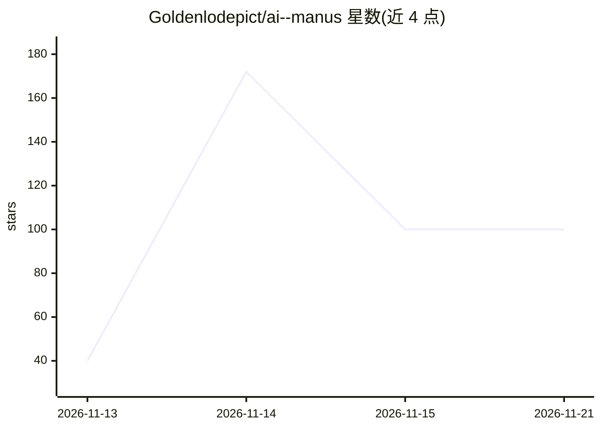

# Goldenlodepict/ai--manus

⭐ 100 · Apache-2.0 · 推送 2026-11-15 · [GitHub](https://github.com/Goldenlodepict/ai--manus) · 个人维护

**面向日常任务的自主 AI Agent：自动写代码并操控浏览器**

Manus 是一个自主 AI 代理，宣称可在用户授权下自行编写并执行脚本、控制浏览器（打开网页、填表、读取信息）、执行多步骤任务，定位为家庭、学习与轻量办公场景的个人助手，非开发者也可使用。README 给出硬件兼容表（最低双核 CPU / 4 GB 内存）与六步上手流程，但未提供任何安装命令、下载链接或代码使用说明；仓库描述称其支持在沙盒环境中运行多种工具。内容以功能宣称与搜索关键词为主，可验证的实施细节有限。

## 筛选速览

| 维度 | 判定 | 备注 |
|---|---|---|
| AI 角色 | `ai-native` | 本体是模型或模型工具 |
| 许可风险 | `permissive` | Apache-2.0 |
| 部署形态 | `None` |  |
| 模型依赖 | — | README 未给出锁定关系 |
| 硬件要求 | — | 无带数字的原话,不猜 |
| 安装摩擦 | `low` | 无编译、无系统依赖或容器化 |
| 成熟度 | — | 结构信号不足 |

## 能力要点

- 自主代码执行：代理自行编写并运行脚本完成任务
- 浏览器控制：导航网页、填写表单、收集信息
- 代码与浏览器操作可在同一流程内衔接
- 跨会话记忆工作流模式，支持后台运行

## 适用场景

- 让学生整理研究笔记、运行小型计算
- 远程办公时从多个网页收集数据并汇总
- 把重复性的小型事务交给代理后台处理

## 场景标签

`AI 助手` `编码 Agent` `浏览器自动化` · 领域:效率与自动化

## 证据(README 行号)

> L10: - **Autonomous Code Execution:** Manus AI agent runs code on its own to complete tasks, so you can focus on decisio
> L18: Manus is an autonomous AI agent designed to run code and control a browser on your behalf. Instead of acting like a

## 星数曲线

2026-11-13 40 → 2026-11-21 100（+60）

---
*卡片 v1 · prompt 1.4 · 生成 2026-11-17 · 置信度 mid · 依据 README sha `0f78ee3a5dd2` · [字段定义](../../DATASET.md)*
