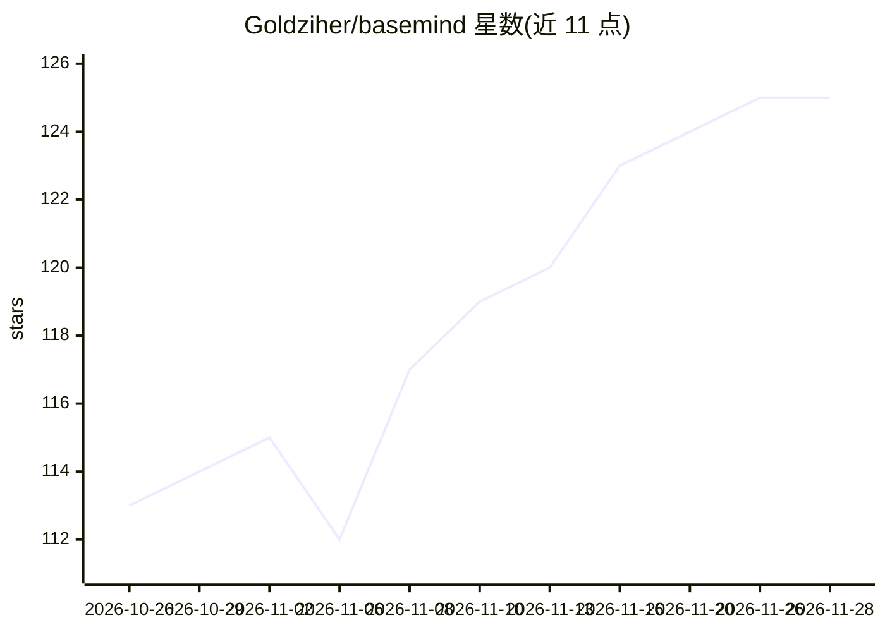

# Goldziher/basemind

⭐ 125 · Rust · MIT · 推送 2026-11-27 · [GitHub](https://github.com/Goldziher/basemind) · [官网](https://basemind.ai) · 个人维护

**给编码 agent 提供代码索引、文档检索与协作的 MCP 服务器**

以 MCP 服务器形态为编码 agent 提供上下文与通信能力：tree-sitter 解析 300+ 种语言生成代码地图，支持符号定义/调用点查询、按含义搜索 PDF/Office/HTML 等文档（含 OCR 与命名实体识别）、agent 共享记忆与同机多 agent 消息线程、git log/blame/diff。另提供等价 CLI 命令。程序用 Rust 编写，通过 Homebrew/npm/pip/cargo/GitHub releases 分发，或作为 Claude Code、Codex、Cursor 等 10+ 种 harness 的插件安装。首个查询前需构建索引。

## 筛选速览

| 维度 | 判定 | 备注 |
|---|---|---|
| AI 角色 | `ai-ecosystem` | LLM/agent 周边工具 |
| 许可风险 | `permissive` | MIT |
| 部署形态 | `library` | 以包/库形式分发 |
| 模型依赖 | locked-api |  |
| 硬件要求 | — | 无带数字的原话,不猜 |
| 安装摩擦 | `low` | 无编译、无系统依赖或容器化 |
| 成熟度 | — | 结构信号不足 |

## 能力要点

- tree-sitter 代码地图覆盖 300+ 语言，返回文件、行号与签名
- 文档 RAG 支持 PDF/Office/HTML/邮件/笔记本/图像并附引用
- 同一机器上跨 harness 的 agent 共享消息线程与收件箱
- 每个 MCP 工具都有参数相同的 CLI 命令

## 适用场景

- 让编码 agent 按符号大纲与调用点精准读取代码而非全文搜索
- 对仓库中的文档按含义检索并获取带出处引用的答案
- 多个 agent 会话之间共享笔记与消息协作
- 团队通过提交 basemind.toml 统一索引与扫描配置

## 场景标签

`编码 Agent` `RAG` `文档解析` · 领域:编码与开发

## 证据(README 行号)

> L3: **The context and communication layer for coding agents.**
> L104: ### As an MCP server
> L203: `basemind scan` reads a project once, in parallel. It maps the code with [tree-sitter] across

## 星数曲线

2026-10-26 113 → 2026-11-28 125（+12）

---
*卡片 v1 · prompt 1.4 · 生成 2026-11-28 · 置信度 high · 依据 README sha `30510a776ba1` · [字段定义](../../DATASET.md)*
