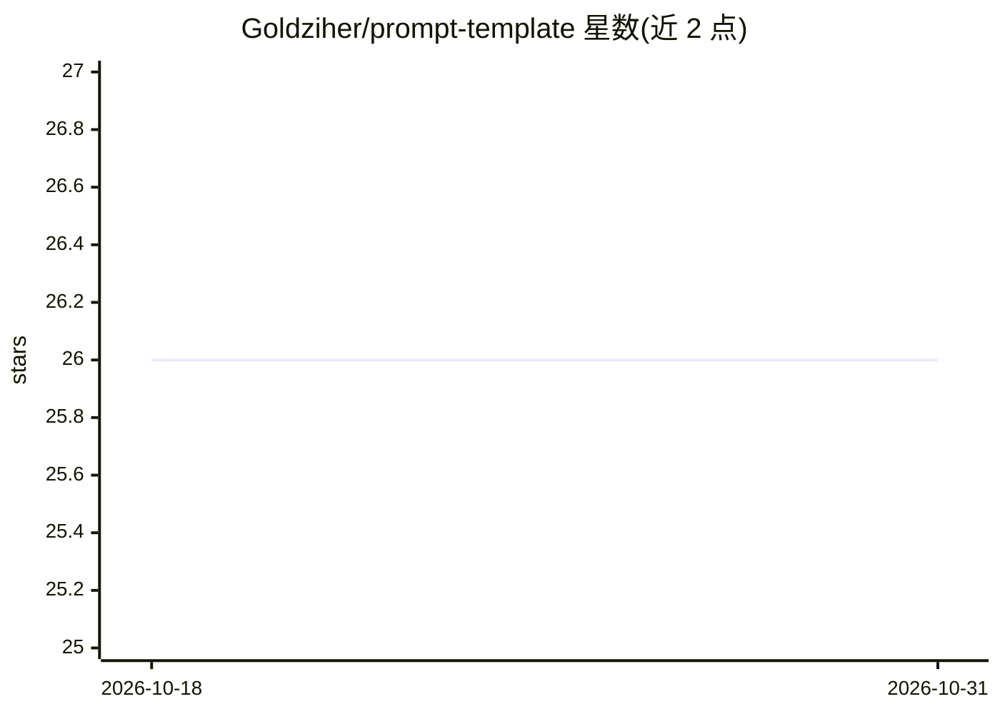

# Goldziher/prompt-template

⭐ 26 · Python · MIT · 推送 2026-10-30 · [GitHub](https://github.com/Goldziher/prompt-template) · 个人维护

**零依赖的 LLM 提示词模板 Python 库**

基于 string.Template 设计原则的轻量级 Python 库，用于创建和管理 LLM 提示词模板。提供强校验与详细错误信息、嵌套花括号与复杂 JSON 结构支持、常见 Python 类型的自动序列化、默认值（含可变类型深拷贝）、增量填充与值继承、命名模板与嵌套模板。零第三方依赖，纯 Python 实现，声明测试覆盖率 100%。通过 pip 安装，MIT 许可。

## 筛选速览

| 维度 | 判定 | 备注 |
|---|---|---|
| AI 角色 | `ai-ecosystem` | LLM/agent 周边工具 |
| 许可风险 | `permissive` | MIT |
| 部署形态 | `library` | 以包/库形式分发 |
| 模型依赖 | — | README 未给出锁定关系 |
| 硬件要求 | — | 无带数字的原话,不猜 |
| 安装摩擦 | `low` | 无编译、无系统依赖或容器化 |
| 成熟度 | — | 结构信号不足 |

## 能力要点

- 强模板校验与专用错误类（缺失值/无效键/序列化错误）
- 常见 Python 类型自动序列化，支持子类化自定义 serializer
- 默认值、嵌套模板与命名模板支持
- 零依赖纯 Python 实现

## 适用场景

- 在 LLM 应用中构建带校验的提示词模板
- 管理含复杂 JSON 结构的提示词
- 为提示词设置默认值并做增量填充

## 场景标签

`提示工程` · 领域:Agent 开发

## 证据(README 行号)

> L3: A lightweight, zero-dependency Python library for managing LLM prompt templates. Built on the design principles of
> L16: - Strong template validation with detailed error messages

## 星数曲线

2026-10-18 26 → 2026-10-31 26（+0）

---
*卡片 v1 · prompt 1.4 · 生成 2026-10-26 · 置信度 high · 依据 README sha `7177bcf0d66e` · [字段定义](../../DATASET.md)*
