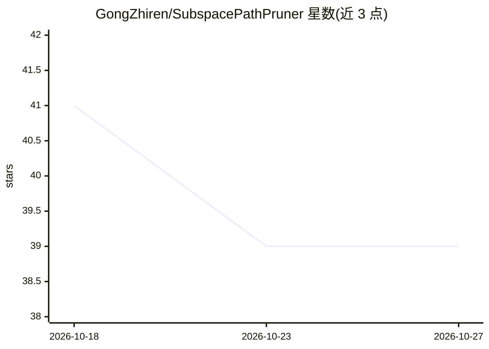

# GongZhiren/SubspacePathPruner

⭐ 39 · Python · MIT · 推送 2026-10-11 · [GitHub](https://github.com/GongZhiren/SubspacePathPruner) · [官网](https://gongzhiren.github.io/SubspacePathPruner-website/) · 个人维护

**ICML 2026 推理时免训练 LLM 结构化剪枝工具**

对冻结 LLM 在推理时生成场景特定的注意力头剪枝掩码：离线阶段训练逐层线性探针、温度校准并计算轴向头重要度与白名单；在线阶段从首轮对话诊断场景域混合，数毫秒编译二值头掩码并在整个会话复用，全程无梯度更新。随附 4 个模型（Qwen2.5-7B/14B、Llama-3.1-8B、Llama-2-13B）的预训练探针与重要度工件，可开箱运行剪枝推理，也提供完整离线复现管线。评估采用精确关键词匹配，无 LLM 裁判；单 GPU 设计，模型权重需自行下载。面向 LLM 压缩方向的研究者与开发者。

## 筛选速览

| 维度 | 判定 | 备注 |
|---|---|---|
| AI 角色 | `ai-ecosystem` | LLM/agent 周边工具 |
| 许可风险 | `permissive` | MIT |
| 部署形态 | `library` | 以包/库形式分发 |
| 模型依赖 | — | README 未给出锁定关系 |
| 硬件要求 | — | 无带数字的原话,不猜 |
| 安装摩擦 | `medium` | 含编译或系统依赖之一 |
| 成熟度 | — | 结构信号不足 |

## 能力要点

- 免训练、免场景数据，推理时编译场景特定头剪枝掩码
- 掩码全会话复用，零逐轮开销，编译耗时数十毫秒
- 预置 4 个模型的探针/重要度/白名单工件，开箱即跑
- 包含离线阶段（探针训练→校准→重要度→白名单）完整复现管线

## 适用场景

- 在预算内对冻结 LLM 做场景化结构化剪枝推理
- 复现论文的剪枝强度扫描与跨数据集评估
- 在自己的模型上重新生成探针与重要度工件

## 场景标签

`模型量化` · 领域:训练与推理

## 证据(README 行号)

> L5: **SubspacePath Pruner compiles a scenario-specific pruned subnetwork of a frozen
> L43: Structured pruning usually needs fine-tuning or scenario-specific training data.

## 星数曲线

2026-10-18 41 → 2026-10-27 39（-2）

---
*卡片 v1 · prompt 1.4 · 生成 2026-10-25 · 置信度 mid · 依据 README sha `929d41b12560` · [字段定义](../../DATASET.md)*
