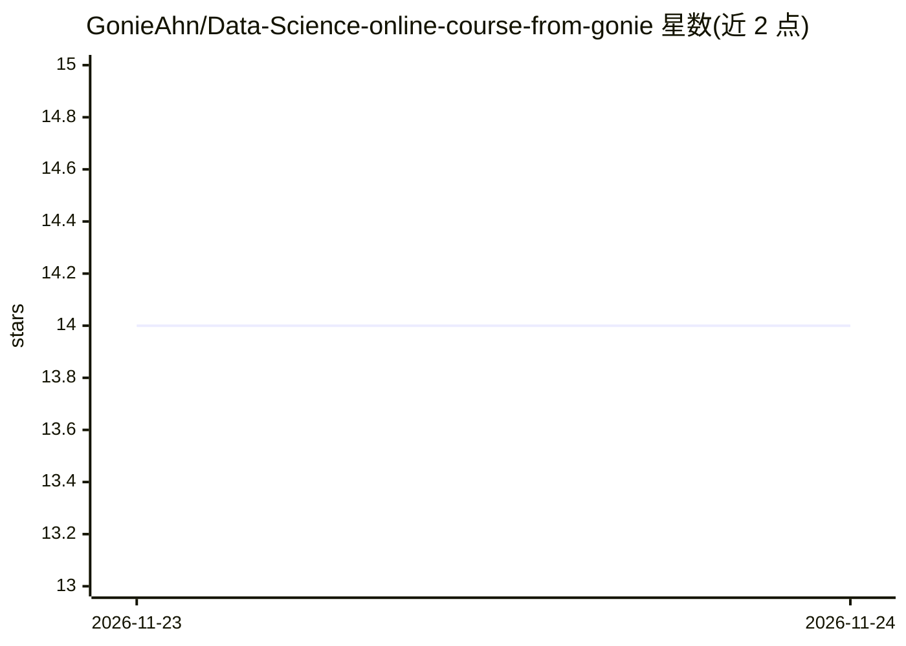

# GonieAhn/Data-Science-online-course-from-gonie

⭐ 14 · Jupyter Notebook · 推送 2026-11-22 · [GitHub](https://github.com/GonieAhn/Data-Science-online-course-from-gonie) · 个人维护

**数据科学在线课程主页：从入门到进阶的讲义与实战代码**

Gonie Ahn 的数据科学课程资料仓库：按 10 个 Class 组织 PDF 讲义与 Jupyter 实战代码，内容覆盖数据分析导入（AWS S3 数据加载、Multiprocessing 读取）、回归与分类、正则化线性模型、集成学习、GBM 家族（XGBoost/LightGBM）、可解释机器学习（LIME/SHAP）、聚类与降维；附 Toy Data 下载与直接从 GitHub 读取 CSV 的代码。部分讲义参考高丽大学 DMQA/DSBA 实验室课程资料。安装命令仅涉及各课程的 Python 依赖包。

## 筛选速览

| 维度 | 判定 | 备注 |
|---|---|---|
| AI 角色 | `ai-knowledge` | 知识聚合/清单类 |
| 许可风险 | `none` | — |
| 部署形态 | `library` | 以包/库形式分发 |
| 模型依赖 | — | README 未给出锁定关系 |
| 硬件要求 | — | 无带数字的原话,不猜 |
| 安装摩擦 | `low` | 无编译、无系统依赖或容器化 |
| 成熟度 | — | 结构信号不足 |

## 能力要点

- 10 个 Class 的 PDF 讲义与 Tutorial Code（Jupyter Notebook）
- Toy Data 以 .csv/.pickle 提供，支持直接从 GitHub 读取
- 覆盖 S3 数据加载、回归/分类、集成学习、GBM、IML、聚类降维
- 推荐高丽大学与 KAIST 实验室的公开课资源

## 适用场景

- 系统学习数据分析与机器学习的基础到进阶内容
- 按讲义跑 Jupyter Notebook 完成数据实战练习
- 查找 XGBoost/LightGBM 调参与 SHAP/LIME 的参考链接

## 场景标签

`教程课程` · 领域:学习与行业

## 证据(README 行号)

> L1: # **Data Science : Online Course from Gonie**
> L12: ## Contents
> L25: ### [Class01] Introduction to Data Analytics - [[Slide]](https://github.com/GonieAhn/Data-Science-online-course-fro

## 星数曲线

2026-11-23 14 → 2026-11-24 14（+0）

---
*卡片 v1 · prompt 1.4 · 生成 2026-11-23 · 置信度 high · 依据 README sha `032619542b1e` · [字段定义](../../DATASET.md)*
