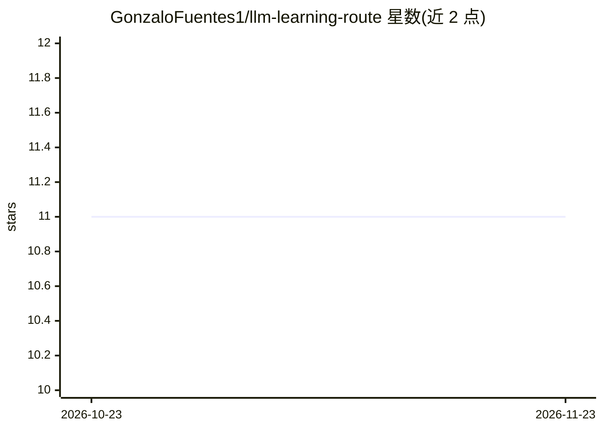

# GonzaloFuentes1/llm-learning-route

⭐ 11 · HTML · 推送 2026-10-20 · [GitHub](https://github.com/GonzaloFuentes1/llm-learning-route) · [官网](https://gonzalofuentes1.github.io/llm-learning-route/) · 个人维护

**LLM 工程学习路线图与 44 篇西语实战指南合集**

源自 LatamGPT（CENIA 的拉美 LLM 项目）的 LLM 工程知识门户：包含 13 个板块、302 个主题的学习路线图，链接 900 余篇 arXiv 论文，另附 7 阶段推荐路线；同时提供 44 篇带可复制代码的西语实战指南，覆盖数据、预训练、后训练、评估与部署，示例侧重西班牙语和葡萄牙语。站点为纯静态 HTML，无构建步骤，通过 git clone 编辑贡献。

## 筛选速览

| 维度 | 判定 | 备注 |
|---|---|---|
| AI 角色 | `ai-knowledge` | 知识聚合/清单类 |
| 许可风险 | `none` | — |
| 部署形态 | `None` |  |
| 模型依赖 | — | README 未给出锁定关系 |
| 硬件要求 | — | 无带数字的原话,不猜 |
| 安装摩擦 | `low` | 无编译、无系统依赖或容器化 |
| 成熟度 | — | 结构信号不足 |

## 能力要点

- 13 板块 302 主题、900+ arXiv 论文链接的学习路线图
- 44 篇带代码的实战指南（数据/预训练/后训练/评估/部署）
- 7 阶段推荐路线作为新手入口
- 纯静态 HTML 站点，无构建步骤

## 适用场景

- 按路线系统学习 LLM 从数据到部署的完整流程
- 查找西语/葡语场景下的 RAG、评估与微调指南
- 按级别（基础/核心/高级/SOTA）筛选研究主题

## 场景标签

`教程课程` · 领域:学习与行业

## 证据(README 行号)

> L3: **English summary.** This repository is a roadmap of LLM engineering topics, from fundamentals to current research, 
> L5: Portal de ingeniería de modelos de lenguaje: una ruta de aprendizaje de fundamentos a SOTA 2026 y guías prácticas co

## 星数曲线

2026-10-23 11 → 2026-11-23 11（+0）

---
*卡片 v1 · prompt 1.4 · 生成 2026-11-19 · 置信度 high · 依据 README sha `d985108bc60c` · [字段定义](../../DATASET.md)*
