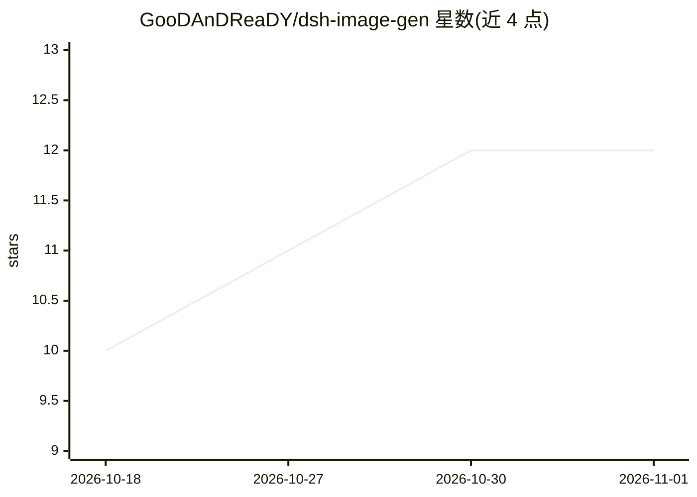

# GooDAnDReaDY/dsh-image-gen

⭐ 12 · JavaScript · MIT · 推送 2026-10-30 · [GitHub](https://github.com/GooDAnDReaDY/dsh-image-gen) · 个人维护 · 中文 README

**DeepSeek Harness 的图像生成与视觉处理插件套件**

面向 DeepSeek Harness（DSH）的 npm 插件，将多家图像生成服务商（FAL、Replicate、OpenAI 兼容端点、ComfyUI、Gemini、Seedream 等）以可插拔方式接入对话界面，并提供 remove_background、upscale_image、vectorize_image、blend_images、smart_crop_image、generate_spritesheet 等视觉工具，附带 10 种风格预设、侧栏 Image Studio 工作面板、生成历史画廊与会话级资产目录。计费生成前可启用交互式审批门（默认关闭，超时 120 秒），支持 DSH Desktop Electron 环境并保持本地回环安全校验，设置卡片内提供一键自动更新。

## 筛选速览

| 维度 | 判定 | 备注 |
|---|---|---|
| AI 角色 | `ai-ecosystem` | LLM/agent 周边工具 |
| 许可风险 | `permissive` | MIT |
| 部署形态 | `None` |  |
| 模型依赖 | locked-api |  |
| 硬件要求 | — | 无带数字的原话,不猜 |
| 安装摩擦 | `low` | 无编译、无系统依赖或容器化 |
| 成熟度 | — | 结构信号不足 |

## 能力要点

- 可插拔多家图像生成服务商并带连接诊断探测
- Image Studio 侧栏工作面板与生成历史画廊
- 计费生成前的交互式审批门（FalApprovalCard，失败零花费）
- 10 种风格预设与提示词增强选项

## 适用场景

- 在 DSH 对话中直接调用多家服务商生成与编辑图片
- 为项目导出图标、PWA 清单与社交横幅等品牌资产
- 对生成图像做抠背景、放大、矢量化、裁切等处理

## 场景标签

`图像生成` `图像视频处理` · 领域:内容生成

## 证据(README 行号)

> L22:  Comprehensive Visual Generation & Image Processing Suite for DeepSeek Harness
> L60: * **One-Click In-App Auto-Updater**: Direct 1-click update support inside the plugin Settings Card (`UpdaterSection
> L79: * **Native Sidebar Gallery & History Drawer**: Integrated directly into DSH's native right sidebar pane (`sidebarRi

## 星数曲线

2026-10-18 10 → 2026-11-01 12（+2）

---
*卡片 v1 · prompt 1.4 · 生成 2026-11-01 · 置信度 high · 依据 README sha `6877d64daa5f` · [字段定义](../../DATASET.md)*
