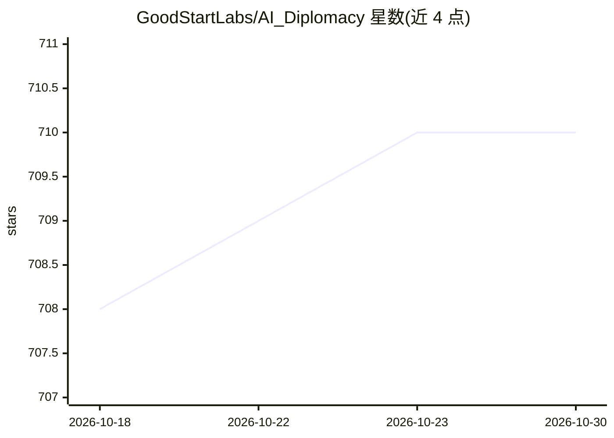

# GoodStartLabs/AI_Diplomacy

⭐ 710 · Python · NOASSERTION · 推送 2026-06-01 · [GitHub](https://github.com/GoodStartLabs/AI_Diplomacy) · 组织维护

**让前沿 LLM 以自主 agent 玩外交棋盘博弈的实验与评测框架**

在外交（Diplomacy）游戏引擎之上构建的有状态 LLM agent 系统：游戏中每个强国由一个 DiplomacyAgent 控制，维护动态目标、敌友关系追踪、双层记忆（结构化日记+年度摘要压缩）与国别人格提示词；支持多轮私聊/全局谈判、BFS 路径分析后的指令生成与背叛检测。提供 lm_game.py 单局运行、experiment_runner.py 并行批量实验（可设种子复现）、CSV→RL JSON 分析管线与赛后关键时刻分析工具。支持 OpenAI、Anthropic、Gemini、DeepSeek、OpenRouter、Together 等多种模型来源，需 API key 或自定义 base_url。

## 筛选速览

| 维度 | 判定 | 备注 |
|---|---|---|
| AI 角色 | `ai-ecosystem` | LLM/agent 周边工具 |
| 许可风险 | `none` | NOASSERTION |
| 部署形态 | `library` | 以包/库形式分发 |
| 模型依赖 | locked-api |  |
| 硬件要求 | — | 无带数字的原话,不猜 |
| 安装摩擦 | `low` | 无编译、无系统依赖或容器化 |
| 成熟度 | — | 结构信号不足 |

## 能力要点

- 每个强国一个有状态 agent：动态目标、五级关系追踪、双层记忆系统
- experiment_runner.py 并行批量实验，种子递增支持可复现批次
- 支持多 LLM 提供商（OpenAI/Claude/Gemini/DeepSeek/OpenRouter/Together）
- 背叛检测与赛后战略时刻分析（背叛/合作/两面派/妙手/失误）

## 适用场景

- 运行多模型对局的 Diplomacy 游戏并观察谈判与背叛行为
- 批量开展 LLM 战略博弈实验并统计分析指令成功率
- 比较不同 LLM 在多轮谈判与战略决策中的表现

## 场景标签

`模型评测` `多智能体` · 领域:Agent 开发

## 证据(README 行号)

> L7: This repository extends the original Diplomacy project with sophisticated AI agents powered by Large Language Models
> L165: `experiment_runner.py` is a lightweight orchestrator: it spins up many `lm_game.py` runs in parallel, gathers thei
> L266: This pipeline allows for a comprehensive understanding of LLM performance in generating valid and successful game 

## 星数曲线

2026-10-18 708 → 2026-10-30 710（+2）

---
*卡片 v1 · prompt 1.4 · 生成 2026-10-21 · 置信度 mid · 依据 README sha `eb8a09d3372b` · [字段定义](../../DATASET.md)*
