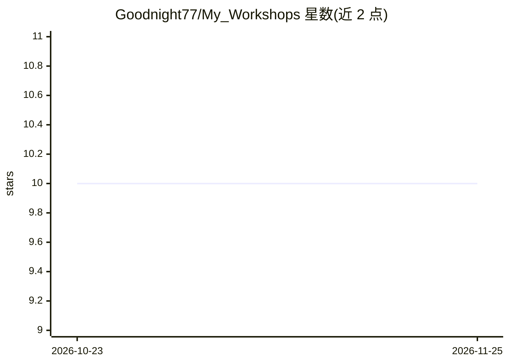

# Goodnight77/My_Workshops

⭐ 10 · HTML · 推送 2026-03-28 · [GitHub](https://github.com/Goodnight77/My_Workshops) · 个人维护

**NLP/RAG/GenAI 实战工作坊的教学资料库**

讲师发布的工作坊材料合集，收录其主讲的 11 场 NLP、LLM、RAG、向量搜索与应用 GenAI 培训内容，按场次文件夹组织，包含 notebook、幻灯片与资源链接。使用者可在 VS Code、Jupyter 或 Colab 中运行 notebook，多数项目附环境说明或 requirements.txt；内容覆盖文本预处理、RAG 原理与去幻觉、Qdrant 向量检索、Agentic RAG 与语义异常检测等主题。

## 筛选速览

| 维度 | 判定 | 备注 |
|---|---|---|
| AI 角色 | `ai-knowledge` | 知识聚合/清单类 |
| 许可风险 | `none` | — |
| 部署形态 | `None` |  |
| 模型依赖 | — | README 未给出锁定关系 |
| 硬件要求 | — | 无带数字的原话,不猜 |
| 安装摩擦 | `low` | 无编译、无系统依赖或容器化 |
| 成熟度 | — | 结构信号不足 |

## 能力要点

- 11 场工作坊的 notebook、幻灯片与配套资源按文件夹组织
- 主题覆盖 RAG 概念、Qdrant 向量搜索、Agentic RAG 与语义异常检测
- notebook 可在 VS Code/Jupyter/Colab 中直接运行，附环境说明

## 适用场景

- 按场次自学 NLP 与 RAG 的入门到进阶内容
- 复用 notebook 与素材搭建自己的课程或演示
- 参考 Qdrant 与 Agentic RAG 的实战示例

## 场景标签

`RAG` `教程课程` · 领域:知识与检索

## 证据(README 行号)

> L4:  ✨ A curated collection of Retrieval-Augmented Generation, NLP, and GenAI workshops powered by LangChain,
> L20: **A curated collection of hands-on sessions I’ve delivered on NLP, LLMs, Retrieval-Augmented Generation, Qdrant, ve
> L22: ## Workshop Index

## 星数曲线

2026-10-23 10 → 2026-11-25 10（+0）

---
*卡片 v1 · prompt 1.4 · 生成 2026-11-20 · 置信度 high · 依据 README sha `e3f70db82bfe` · [字段定义](../../DATASET.md)*
