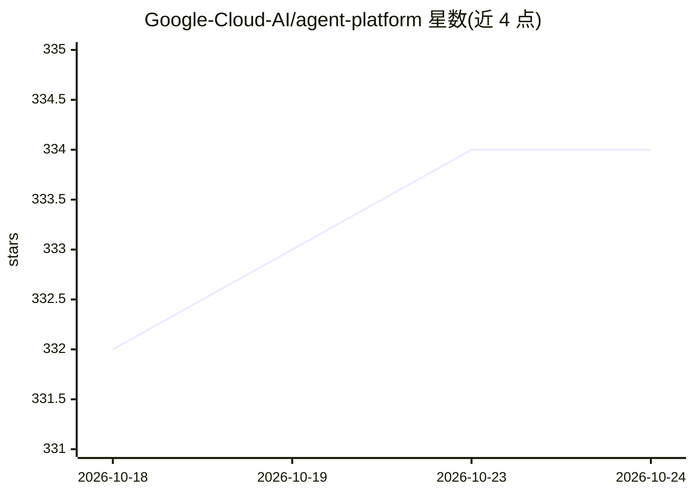

# Google-Cloud-AI/agent-platform

⭐ 334 · Apache-2.0 · 推送 2026-05-27 · [GitHub](https://github.com/Google-Cloud-AI/agent-platform) · [官网](https://docs.cloud.google.com/gemini-enterprise-agent-platform) · 组织维护

**Gemini Enterprise Agent Platform 的代码示例与教程策展清单**

Google Cloud AI 组织维护的策展仓库，汇集在 Gemini Enterprise Agent Platform（原 Vertex AI）上构建 agent 的代码示例与教程：覆盖 Gemini/Veo/Lyria/Nano Banana 等基础模型的入门、ADK 开发框架、A2A/MCP 等协议、RAG 与向量搜索、评测与治理等主题，按核心能力、专用场景、专用模型、嵌入与向量检索分类组织。仓库自身为清单导航形态，不含可运行代码入口；声明非官方支持的 Google 产品。

## 筛选速览

| 维度 | 判定 | 备注 |
|---|---|---|
| AI 角色 | `ai-knowledge` | 知识聚合/清单类 |
| 许可风险 | `permissive` | Apache-2.0 |
| 部署形态 | `None` |  |
| 模型依赖 | — | README 未给出锁定关系 |
| 硬件要求 | — | 无带数字的原话,不猜 |
| 安装摩擦 | `low` | 无编译、无系统依赖或容器化 |
| 成熟度 | — | 结构信号不足 |

## 能力要点

- 策展 Gemini Enterprise Agent Platform 的代码示例与教程链接
- 覆盖基础模型、开发框架、协议、RAG/向量搜索、评测治理等平台能力介绍
- 按核心能力/专用场景/专用模型/嵌入检索分类组织教程条目

## 适用场景

- 查找平台上各能力的官方入门教程与 notebook
- 了解 Agent Platform 的功能版图与模型能力
- 按主题定位特定模型（Veo/Lyria/Nano Banana）的使用示例

## 场景标签

`教程课程` `精选清单` · 领域:学习与行业

## 证据(README 行号)

> L3: A curated list of code samples and tutorials for building agents on **Gemini Enterprise Agent Platform** (previously
> L70: ## 🪜 Tutorials & Notebooks

## 星数曲线

2026-10-18 332 → 2026-10-24 334（+2）

---
*卡片 v1 · prompt 1.4 · 生成 2026-10-22 · 置信度 high · 依据 README sha `da8f6fe775a7` · [字段定义](../../DATASET.md)*
