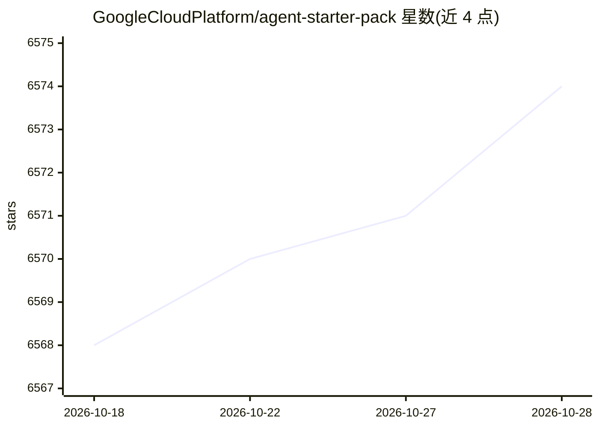

# GoogleCloudPlatform/agent-starter-pack

⭐ — · [GitHub]() · 组织维护

**Google Cloud 上构建与部署 GenAI agent 的生产级模板包**

Google CloudPlatform 维护的 Python 包，为 GenAI agent 提供生产就绪模板（ReAct、RAG、多 agent、Live API 等），配套基础设施、CI/CD（Cloud Build/GitHub Actions）、Terraform 部署到 Cloud Run 或 Agent Engine、Vertex AI 评测与可观测性，一条命令脚手架或为已有 agent 补充部署基础设施。需 Python 3.10+、Google Cloud SDK、Terraform。README 顶部声明项目进入维护模式，仅接收关键修复，活跃开发已转移至 agents-cli。

## 筛选速览

| 维度 | 判定 | 备注 |
|---|---|---|
| AI 角色 | `ai-ecosystem` | LLM/agent 周边工具 |
| 许可风险 | `permissive` | — |
| 部署形态 | `library` | 以包/库形式分发 |
| 模型依赖 | — | README 未给出锁定关系 |
| 硬件要求 | — | 无带数字的原话,不猜 |
| 安装摩擦 | `low` | 无编译、无系统依赖或容器化 |
| 成熟度 | — | 结构信号不足 |

## 能力要点

- 一条 uvx/pip 命令生成含前后端与部署基础设施的 agent 项目
- 提供 adk、langgraph、agentic_rag、live 等多种 agent 模板
- 内置 CI/CD、Terraform 部署、Vertex AI 评测与监控
- uvx agent-starter-pack enhance 可为已有 agent 补充生产部署能力

## 适用场景

- 快速搭建可部署到 Google Cloud 的 GenAI agent 项目
- 为已有 agent 补充 CI/CD、部署与可观测性基础设施
- 基于模板实验 RAG、多 agent、实时多模态等 agent 模式

## 场景标签

`Agent 框架` `多智能体` `RAG` · 领域:Agent 开发

## 证据(README 行号)

> L36: A Python package that provides **production-ready templates** for GenAI agents on Google Cloud.
> L38: Focus on your agent logic—the starter pack provides everything else: infrastructure, CI/CD, observability, and secu

## 星数曲线

2026-10-18 6,568 → 2026-10-28 6,574（+6）

---
*卡片 v1 · prompt 1.4 · 生成 2026-10-20 · 置信度 mid · 依据 README sha `4c7e694f4ae2` · [字段定义](../../DATASET.md)*
