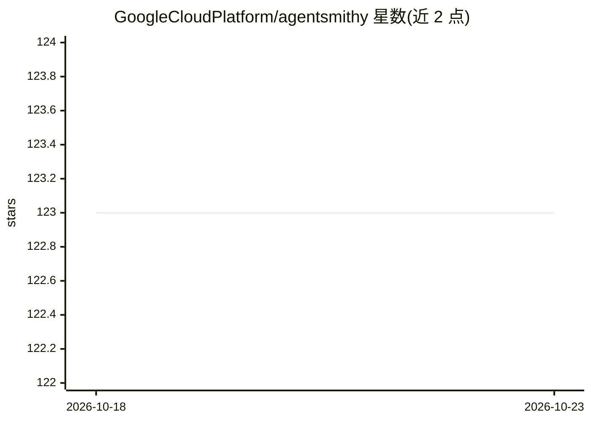

# GoogleCloudPlatform/agentsmithy

⭐ 123 · Python · Apache-2.0 · 推送 2026-07-10 · [GitHub](https://github.com/GoogleCloudPlatform/agentsmithy) · 组织维护

**谷歌云多智能体运行时：按行业编排、运行与管理 AI agent**

Multi-Agent Quest（Agent Bar v2）是面向 Google Cloud 的多智能体运行时，提供 agent 通信、动态状态管理与工具集成的基础设施。代码库按行业组织子智能体：医疗生命科学、金融服务、零售、媒体与跨行业，覆盖医学文献检索、迁移翻译、日志分析、视频转录、知识图谱构建等用例，部分 agent 为概念模型尚未实例化（L70），Finsights 子智能体未包含在开源发布中（L88-89）。部署通过 Cloud Shell 按钮与 setup.md 引导。

## 筛选速览

| 维度 | 判定 | 备注 |
|---|---|---|
| AI 角色 | `ai-ecosystem` | LLM/agent 周边工具 |
| 许可风险 | `permissive` | Apache-2.0 |
| 部署形态 | `None` |  |
| 模型依赖 | — | README 未给出锁定关系 |
| 硬件要求 | — | 无带数字的原话,不猜 |
| 安装摩擦 | `low` | 无编译、无系统依赖或容器化 |
| 成熟度 | — | 结构信号不足 |

## 能力要点

- 提供 agent 通信、动态状态管理与工具集成的运行时基础设施
- 按行业分类的子智能体目录（HCLS/FSI/零售/媒体/跨行业）
- agent_registry.py 中央注册表按会话状态映射可用 agent 与行业提示
- Cloud Shell 一键启动交互式部署教程

## 适用场景

- 在 Google Cloud 上构建与部署行业定制的多智能体系统
- 利用预置 agent 组合（如医学文献检索→研究问题→假设生成）完成业务流程
- 参考行业 agent 编排模式开发自有 agent 应用

## 场景标签

`多智能体` `Agent 框架` · 领域:Agent 开发

## 证据(README 行号)

> L5: **Multi-Agent Quest** (aka Agent Bar v2) is a robust multi-agent runtime designed to facilitate the orchestration, e
> L16:  - `agent_registry.py`: The central registry mapping available agents and industry-specific prompts based on sessio

## 星数曲线

2026-10-18 123 → 2026-10-23 123（+0）

---
*卡片 v1 · prompt 1.4 · 生成 2026-10-23 · 置信度 high · 依据 README sha `9beb658c5bce` · [字段定义](../../DATASET.md)*
