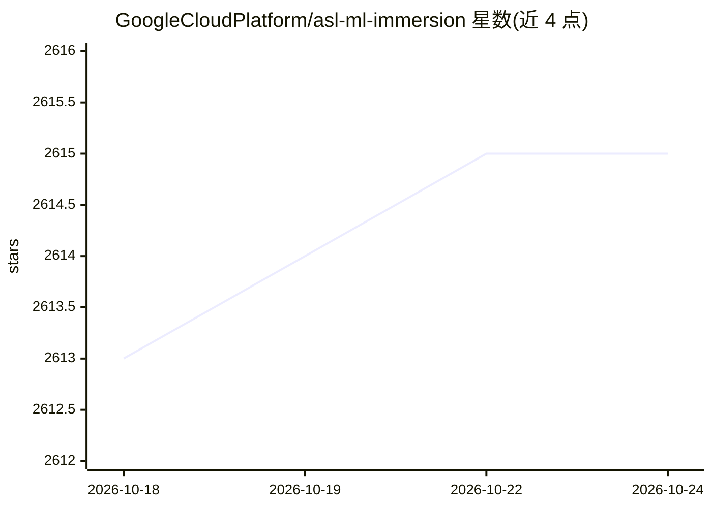

# GoogleCloudPlatform/asl-ml-immersion

⭐ 2,616 · Jupyter Notebook · Apache-2.0 · 推送 2026-10-22 · [GitHub](https://github.com/GoogleCloudPlatform/asl-ml-immersion) · 组织维护

**Google Cloud 上的 AI/ML 与生成式 AI 培训课程代码仓库**

由 Google Cloud Advanced Solutions Lab 团队维护的培训内容仓库，包含三大模块：asl_core（TensorFlow/Keras 实现的 DNN、CNN、RNN、transformers、SNGP 等模型架构）、asl_mlops（模型规模化训练调优部署与 Kubeflow 管线 MLOps）、asl_genai（基于 Gemini 与 Google ADK 的生成式 AI 与 Agent 系统）。提供 Cloud Shell 安装脚本与 Makefile 构建 venv 和 Jupyter 内核，在 Vertex AI Workbench 或 Cloud Workstations 上运行 notebook 实验（labs 与 solutions 对照）。

## 筛选速览

| 维度 | 判定 | 备注 |
|---|---|---|
| AI 角色 | `ai-knowledge` | 知识聚合/清单类 |
| 许可风险 | `permissive` | Apache-2.0 |
| 部署形态 | `None` |  |
| 模型依赖 | — | README 未给出锁定关系 |
| 硬件要求 | — | 无带数字的原话,不猜 |
| 安装摩擦 | `low` | 无编译、无系统依赖或容器化 |
| 成熟度 | — | 结构信号不足 |

## 能力要点

- 三大模块覆盖模型架构、MLOps 与生成式 AI/Agent
- labs 与 solutions 双 notebook 结构用于练习与验证
- setup_env.sh 一键配置项目基础设施（APIs、IAM、Buckets）与计算环境
- 内容主要基于 TensorFlow/Keras，另含 Scikit-learn、PyTorch 与 Google ADK

## 适用场景

- 参加 ASL 培训营的学员跟随 notebook 学习 AI/ML
- 在 Google Cloud 上动手实验从建模到 MLOps 的完整流程
- 学习使用 Gemini 与 Google ADK 构建生成式 AI 与 Agent 系统

## 场景标签

`教程课程` `MLOps` · 领域:学习与行业

## 证据(README 行号)

> L4: This repository contains AI and Machine Learning contents meant to be run on Google Cloud. This is maintained by Goo
> L6: This repository contains 3 main modules to covers various AI/ML topics:

## 星数曲线

2026-10-18 2,613 → 2026-10-24 2,615（+2）

---
*卡片 v1 · prompt 1.4 · 生成 2026-10-21 · 置信度 high · 依据 README sha `55b8d1efe766` · [字段定义](../../DATASET.md)*
